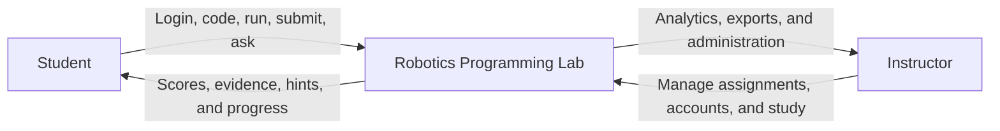

# Robotics Programming Lab

A local-first robotics education platform. Students complete Python and ROS 2
assignments in Flutter, FastAPI runs the assignment workflow, and test cases
remain the only grading authority. AI tutoring is optional and off by default.

This is the **staging repository**. Development and SQA happen here before an
approved release is promoted to the separate live repository.

## Quick start

Open PowerShell in the repository root. The path may differ between computers;
you do not need to type a fixed username or OneDrive path.

For a new computer, follow the complete
[first-time run guide](docs/guides/FIRST_TIME_RUN.md). It covers required
software, Git-clone setup, automatic package installation, ROS setup, and the
single local data package.

Prepare this computer once, or after dependency changes:

```powershell
.\scripts\setup-local.ps1
```

Start the application:

```powershell
.\scripts\run-local.ps1 -FrontendPort 8180 -BackendPort 5100 -SandboxPort 5101
```

Open the frontend URL printed by the script, normally
`http://127.0.0.1:8180/app`. Keep the PowerShell window open.

Stop the application:

```powershell
.\scripts\stop-local.ps1
```

The launcher starts local PostgreSQL in Docker, the Python sandbox, FastAPI
backend, and Flutter web app. Python and Flutter generated files stay in this
computer's LocalAppData. Database backups and private settings are read from
the single ignored `local_handoff_package` folder. If no backup exists there,
the computer starts a fresh demo database and creates one at the next clean
stop. Do not run
manual Flutter, pip, or PostgreSQL restore commands; the scripts handle them.

### Copy the same local data to another computer

While the application is stopped, create the ignored handoff package:

```powershell
.\scripts\create-local-handoff-package.ps1 -IncludePrivateConfig
```

Copy the complete `local_handoff_package` folder into the root of a fresh Git
clone. The normal setup and run commands use it directly. It contains the
verified database and optional private `.env`, but not the Python
virtual environment. Python packages are rebuilt safely under LocalAppData on
the destination computer.

## Local demo accounts

The local database seeds these prototype accounts on first start:

```text
Student:    student / student
Instructor: instructor / instructor
```

Change the credentials before a real classroom study. The login page does not
display them.

## What is implemented

- Six configurable, versioned assignments: four Python and two ROS 2 exercises
- Test-case grading with server-only hidden evidence and maintained answers
- Student coding workspace, version-scoped local drafts, results, progressive
  hints, and study progress
- Instructor assignment, account, analytics, and research-export tools
- Server-side sessions and role authorization
- PostgreSQL in a local Docker volume with verified package backups
- Explicit `-UseSqlite` fallback for disposable troubleshooting only
- Dedicated local Python sandbox and Docker-based ROS 2 grader
- Built-in tutoring plus optional OpenAI feedback that never changes grades
- Privacy-safe learning events, attempts, participant analytics, CSV, and Excel
  exports

## Technology stack

| Layer | Technology | Purpose |
| --- | --- | --- |
| Interface | Flutter and Dart | Student and instructor web experience |
| API | Python 3.14, FastAPI, Uvicorn, Pydantic | Authentication, assignments, grading, tutoring, and research APIs |
| Persistence | SQLAlchemy, Alembic, PostgreSQL 17 | Versioned assignments, users, attempts, and study data |
| Python grading | Dedicated sandbox service | Bounded execution of untrusted Python submissions |
| ROS 2 grading | ROS 2 Jazzy Docker image | Builds packages and checks observable topic behavior |
| AI tutoring | Built-in tutor; optional OpenAI Responses API | Progressive feedback without grading or solution disclosure |
| Hosted interface | Flutter web and Vercel when promoted | Serves an approved release |
| Hosted API | Render when promoted | Runs the approved API and sandbox release |

## Application model



## Technical architecture


Flutter never grades submissions or stores protected answers. FastAPI loads
the exact assignment version, sends minimal code to the correct isolated
grader, stores structured evidence, and supplies only student-visible evidence
to the tutor. Browser drafts are tied to the assignment version, so code saved
for an older version is not silently reused after an instructor publishes a
newer assignment. Test cases remain the scoring authority.

## Repository map

```text
backend/              FastAPI app, data models, graders, assignments, and tests
frontend/             Flutter student and instructor interface
course_materials/     Controlled course sources plus a labeled history archive
manual_sqa_answers/   Maintained instructor answers for manual SQA
docs/                 Architecture, deployment, research, and SQA documents
  archive/             Superseded reports and deployment snapshots
scripts/              Setup, run, stop, verification, and release automation
local_handoff_package/ Ignored, copyable database and private configuration
LocalAppData           Generated Python, Flutter, and runtime files; never committed
```

The documentation index is [docs/README.md](docs/README.md). Engineering and
security rules are in [AGENTS.md](AGENTS.md).

## AI option

AI is off by default. Normal grading and built-in hints do not require an API
key. To intentionally test optional AI feedback, place `OPENAI_API_KEY` in the
ignored `local_handoff_package/.env` file and start with:

```powershell
.\scripts\run-local.ps1 -EnableAi -FrontendPort 8180 -BackendPort 5100 -SandboxPort 5101
```

Provider failure or missing credit must not block grading. Hidden tests,
official solutions, secrets, and unrelated student data are excluded from the
AI context.

## Verification

Run the complete local gate from the repository root:

```powershell
.\scripts\verify-local.ps1 -ApiBaseUrl http://127.0.0.1:5100
```

It checks fresh-clone completeness, then runs backend tests, dependency checks, Python compilation, Flutter analysis
and tests, a release web build from LocalAppData, an isolated PostgreSQL
backup/restore and simulated-device-lock test, Git whitespace validation, and
a dry-run validation of the safe cleanup allow-list. It also checks managed
service health when the stack is running.

Check the three local services manually when using the example ports:

```powershell
Invoke-WebRequest -UseBasicParsing http://127.0.0.1:8180/app
Invoke-RestMethod http://127.0.0.1:5100/health
Invoke-RestMethod http://127.0.0.1:5101/health
```

For ROS 2 validation:

```powershell
.\scripts\check-ros2-local.ps1
```

## Safe local cleanup

Preview rebuildable local artifacts from the repository root:

```powershell
.\scripts\clean-local.ps1
```

After stopping the application, remove only that fixed allow-list:

```powershell
.\scripts\stop-local.ps1
.\scripts\clean-local.ps1 -Execute
```

The cleanup script protects databases, PostgreSQL backups, generated
PDF outputs, course materials, instructor answers, and Git history. Flutter and
Python regenerate the removed caches during the next setup, test, or run.

## Advanced configuration

Local use defaults to the Docker PostgreSQL service. Its live Docker volume is
computer-local and must never be synchronized. The verified logical dump,
checksum manifest, previous recovery copy, and private `.env` all live directly
inside `local_handoff_package`. The launcher restores that dump on a new
computer or when the computer's Docker volume has been recreated and no
application schema remains. Use `-DatabasePort 55432` if port 5432 is occupied.
Use `-UseSqlite` only for a disposable offline troubleshooting run; that mode is
not part of the cross-device handoff workflow.

Copy `backend/.env.example` to ignored `local_handoff_package/.env` only when
you need optional settings. Production deployment, study-account import, API details, and
research-data contracts are documented under `docs/` and `backend/README.md`.

Never commit `.env`, databases, credentials, API keys, Python environments,
logs, or generated Flutter output. Do not promote staging to the live
repository until the complete SQA gate passes and the project owner approves
the exact commit.
