# Robotics Programming Lab

[](https://rpl.ponkoj.com/app)

A classroom and research platform for robotics programming. Students read
short lessons, take topic quizzes, and complete versioned Python and ROS 2
assignments in the browser. Every submission is graded by test cases on the
server. Instructors manage assignments and accounts and review privacy-safe
research analytics. Each student account has an instructor-assigned feedback
mode for the study: Traditional, TDD, or TDD + AI. AI tutoring is optional and
off by default.

**Live site:** <https://rpl.ponkoj.com/app>

This is the **live repository**: `main` is the release currently running at
the address above. New work is developed and checked in a separate staging
repository first.

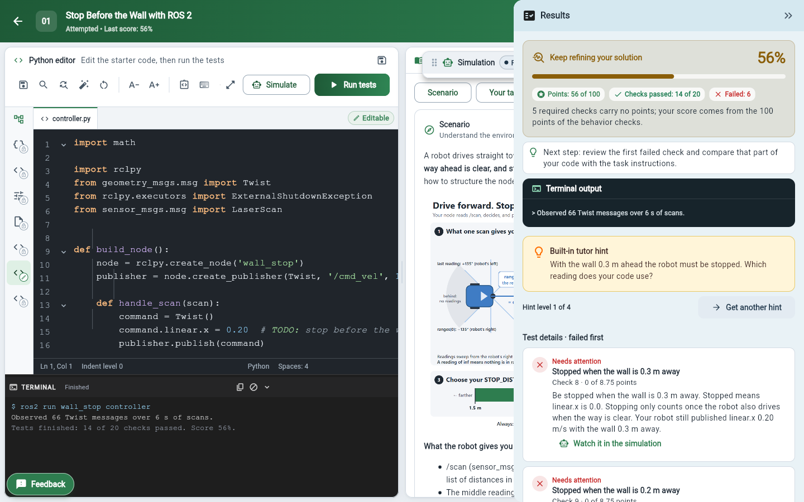

## Tour

Screenshots are from the live site using **Try the student demo**, which uses
the TDD feedback mode (green theme).

| | |
|---|---|
| 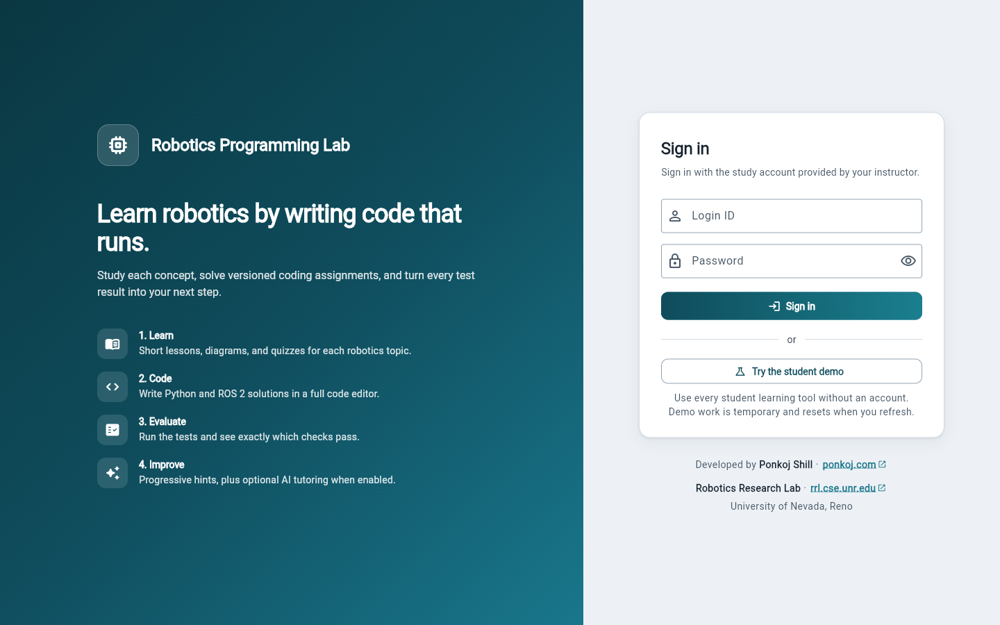 | 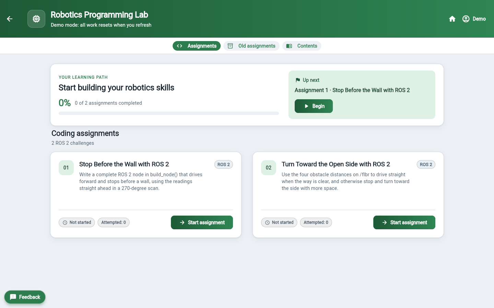 |
| **Sign in or try the demo.** No account needed for the demo, and nothing is saved. | **Home.** A learning path, progress, and the current assignments; earlier ones are under **Old assignments**. |
| 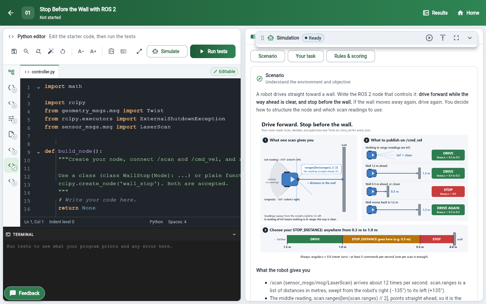 | 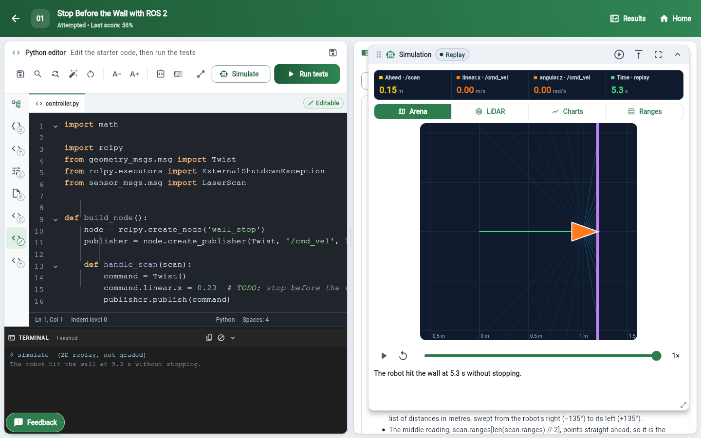 |
| **Instructions beside the code.** Scenario, task, and rules with to-scale diagrams. | **Simulation.** Press Simulate to watch your ROS 2 node drive the robot in a 2D world. Visual only, never graded. |
| 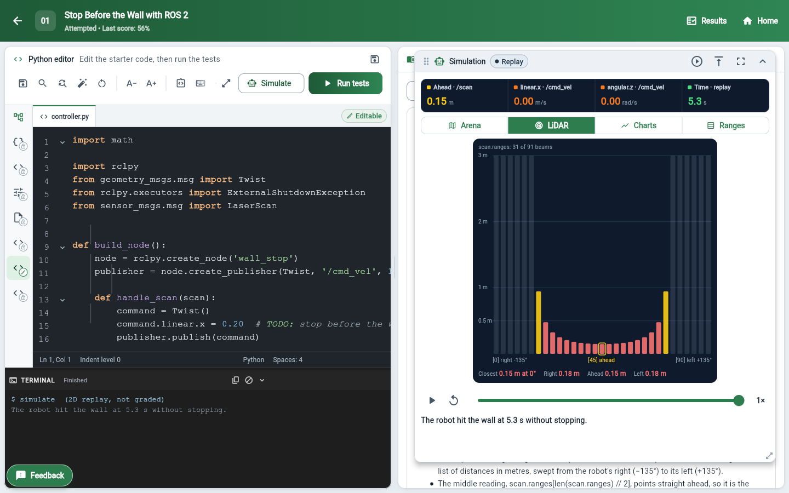 | 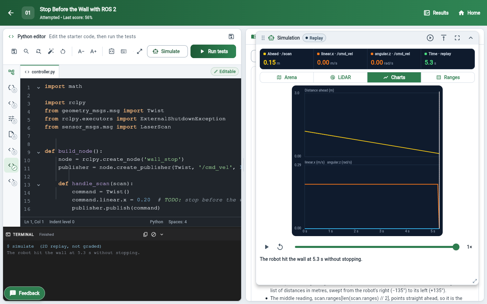 |
| **LiDAR view.** The scan your node received at each moment, beam by beam. | **Charts.** Distance ahead and the speeds your node published, over the whole run. |
| 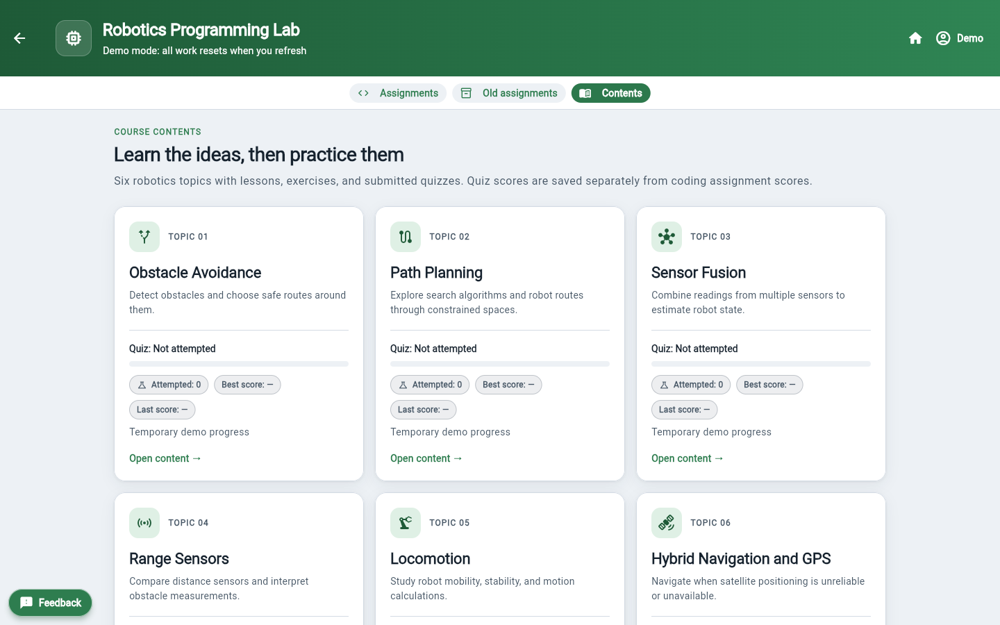 | 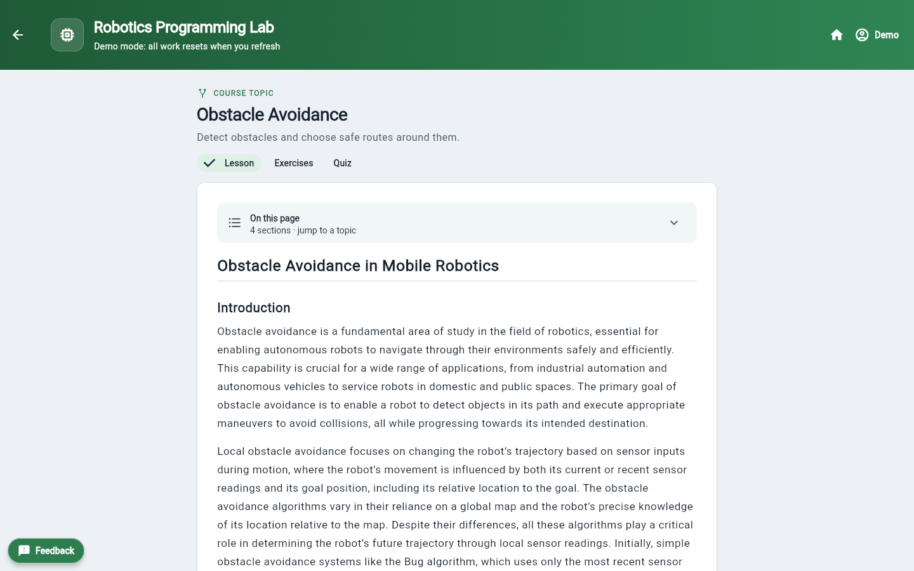 |
| **Course contents.** Each topic has a lesson, exercises, math practice, and a quiz. | **Lessons.** Readable pages with a jump-to-section menu. |

<p align="center">
  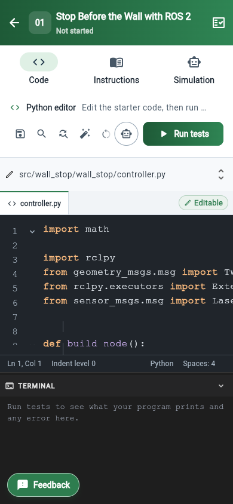<br>
  <em>The same workspace on a phone: Code, Instructions and Simulation tabs, terminal under the editor.</em>
</p>

## What it does

- **Two current ROS 2 Jazzy assignments,** shown to students as Assignments 1
  and 2: stop before a wall using a laser scan (internal Assignment 7), and
  turn toward the open side using four obstacle distances (internal
  Assignment 8). Each has a 2D simulation replay. Six earlier assignments
  (four Python exercises on Bug algorithms, multi-floor navigation and a
  simplified Vector Field Histogram, and two ROS 2 exercises) stay under
  **Old assignments**.
- **Three feedback modes,** set per student on the Accounts page and enforced
  by the server: **Traditional** (score, number of checks passed, and the
  plain simulation replay), **TDD** (check names and messages, printed
  output, the full simulation; no hints) and **TDD + AI** (TDD plus hints: the AI tutor with the built-in
  hint ladder as its fallback). Grading is identical
  in every mode, every attempt records its mode, and each mode has its own
  gradient theme (blue, green, bronze; instructors keep teal).
- **Test-case grading:** public and server-only hidden checks, with structured
  feedback and partial credit where the instructions state it. Grades never
  depend on AI.
- **Student workspace:** code editor with formatting, completion, and
  search/replace; a terminal under the editor with printed output, errors
  linked to the failing line, and a test summary; a Results panel;
  progressive built-in hints; and drafts saved per assignment version.
- **Try inputs playground:** students call their own function with labelled
  inputs (ungraded, never saved) and see a to-scale route map or a polar VFH
  view of the result.
- **Course content:** the current topic, ROS 2 for Mobile Robots, prepares
  students for the two ROS 2 assignments with a lesson, copyable code
  examples, animations that play on their own with a Stop button,
  interactive "Try it" tools,
  exercises and math practice with worked answers shown on request, a
  one-attempt 15-question pre-test before the lesson, and a 15-question quiz.
  The six earlier topics stay available under Old contents. Quizzes are graded
  on the server and stored separately from assignment scores; the first
  submitted attempt is the quiz score, later attempts are practice, and after
  a submit each question shows its correct answer.
- **Instructor Studio:** assignment management and publishing, account management with feedback modes and per-account sign-in history,
  assignment-version analytics, data-health checks, and CSV/Excel research
  exports that use participant codes instead of login IDs.
- **Student demo:** a **Try the student demo** button opens a temporary,
  memory-only session. Refreshing the page resets it and nothing is saved.

## How it runs

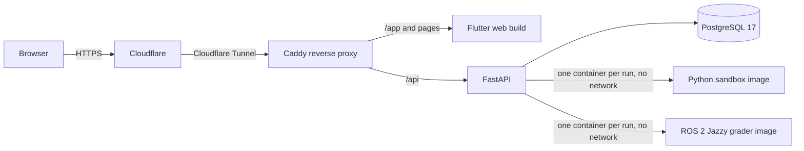

| Part | Technology | Role |
|---|---|---|
| Interface | Flutter web (Dart) | Student and instructor screens |
| API | Python 3.14, FastAPI, Uvicorn, Pydantic | Sign-in, assignments, grading, tutoring, research |
| Data | SQLAlchemy, Alembic, PostgreSQL 17 | Accounts, versioned assignments, attempts, study data |
| Python grading | Docker sandbox image | Runs each untrusted submission with no network and strict limits |
| ROS 2 grading | ROS 2 Jazzy Docker image | Builds the student package and checks its topic behavior |
| Public access | Cloudflare Tunnel and Caddy | HTTPS at one address, with the API under `/api` |
| Tutoring | Built-in hints; optional OpenAI | Feedback that never changes grades or reveals solutions |

The live instance is self-hosted on a dedicated machine. The web app and API
listen only on that machine. Cloudflare Tunnel makes an outbound connection,
so no inbound ports are open. The browser never grades code or receives hidden
tests or official solutions.

## Run it locally

Local development connects to a private Neon staging database and needs a
private `.env` file, so it is meant for authorized contributors. Follow the
[first-time run guide](docs/guides/FIRST_TIME_RUN.md), then the guide for
[Windows](docs/guides/FIRST_TIME_RUN_WINDOWS.md) or
[Ubuntu](docs/guides/FIRST_TIME_RUN_UBUNTU.md).

```powershell
.\scripts\setup-local.ps1   # once, or after dependency changes
.\scripts\run-local.ps1     # opens http://127.0.0.1:8180/app
.\scripts\stop-local.ps1
```

Ubuntu uses `./scripts/setup-local.sh`, `./scripts/run-local.sh`, and
`./scripts/stop-local.sh`.

The self-hosted live stack is started with `scripts/run-live.ps1` and stopped
with `scripts/stop-live.ps1`. It requires `ENVIRONMENT=production` and
`SELF_HOSTED_DATABASE=true` in the machine's private `.env`; see
`backend/.env.example`.

To deploy, run `scripts/run-live.ps1` on its own: it builds the web app while
the old stack keeps serving, then replaces the running processes. For a
backend-only change use `scripts/run-live.ps1 -SkipBuild -Restart`. Only one
launch runs at a time; the scheduled `RPL-Live` task (a watchdog that runs
`-SkipBuild` every five minutes) skips its run while a deploy is in progress,
so it can no longer start a second copy of the stack.

On the live PC the OpenAI key is a managed secret, not a `.env` line: run
`scripts/set-live-secret.ps1` (hidden prompt; stored encrypted with Windows
DPAPI for that Windows user under LocalAppData), then restart the stack.
`run-live.ps1` gives the key to the API process only and prints whether it is
configured, never the key. `-Remove` deletes it. AI answers need five things: an `OPENAI_API_KEY` on the server, AI tutoring
turned on in Instructor Studio > AI tutor (off by default, with a daily limit
per student), the assignment's AI test cases approved by a named instructor
for its current version (`backend/ai_evaluation_cases`), a student account in
the TDD + AI feedback mode, and quota left for the student today. Otherwise students get the built-in hints and a short
reason.

## Verification

```powershell
.\scripts\verify-local.ps1
```

This runs the backend test suite, dependency and compile checks, Flutter
analysis, tests, and a release web build. `scripts/run-browser-tests.ps1`
drives the student demo and an instructor session in a real browser, and
`scripts/check-ros2-local.ps1` checks the ROS 2 grader.

## Security and privacy

- Hidden tests, official solutions, and grader secrets stay on the server.
- Every submission is treated as hostile and runs in an isolated container.
- Student identity comes from the server session, never from the browser.
- Production refuses wildcard CORS, SQLite, automatic schema creation, and
  default or short account passwords.
- Research exports exclude passwords, tokens, and submitted source code.
- Secrets live only in an ignored `.env` file and are never committed.

## Repository map

```text
backend/              FastAPI app, models, graders, assignments, migrations, tests
frontend/             Flutter student and instructor interface
course_materials/     Course source documents
docs/                 Architecture, deployment, research, and QA records
scripts/              Setup, run, stop, live hosting, and verification scripts
```

More detail: the [system architecture blueprint](docs/system-architecture/PRD.md)
(PRD, app flow, UI spec, technical requirements, data schema, and plan),
the [documentation index](docs/README.md),
[backend notes](backend/README.md), and the engineering rules in
[AGENTS.md](AGENTS.md).
