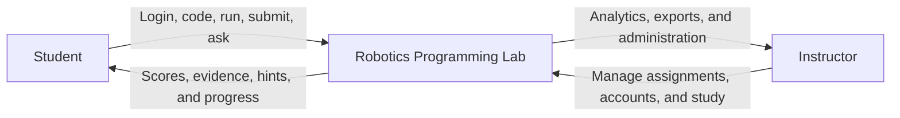
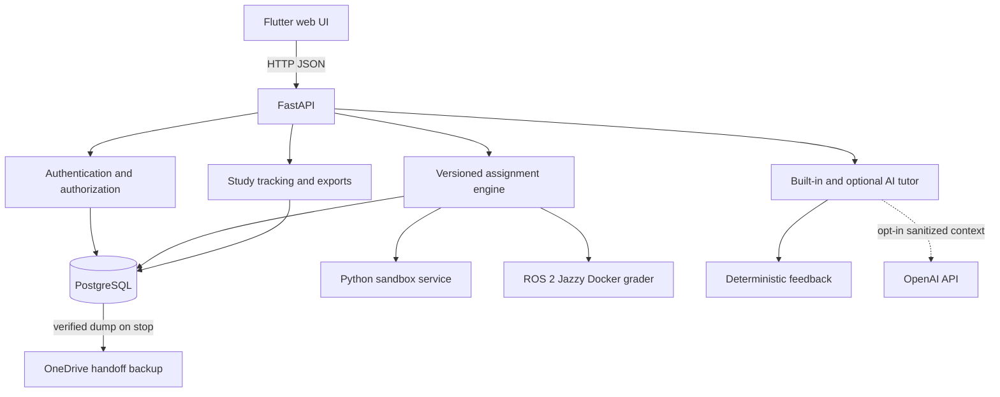

# Robotics Programming Lab

A local-first robotics education platform. Students complete Python and ROS 2
assignments in Flutter, FastAPI runs the assignment workflow, and test cases
remain the only grading authority. AI tutoring is optional and off by default.

This is the **staging repository**. Development and SQA happen here before an
approved release is promoted to the separate live repository.

## Run it on this computer

Open PowerShell in the repository root. The path may differ between computers;
you do not need to type a fixed username or OneDrive path.

First setup on this computer:

```powershell
.\scripts\setup-local.ps1
```

Start the application:

```powershell
.\scripts\run-local.ps1 -FrontendPort 8180 -BackendPort 5100 -SandboxPort 5101
```

Open the frontend URL printed by the script, normally
`http://127.0.0.1:8180/app`. Keep the PowerShell window open.

Stop the application:

```powershell
.\scripts\stop-local.ps1
```

The launcher starts local PostgreSQL in Docker, the Python sandbox, FastAPI
backend, and Flutter web app. On stop, it writes a verified complete PostgreSQL
backup into the OneDrive-synchronized `local_database_backups/` directory.
It runs Flutter from LocalAppData so OneDrive cannot lock Flutter build files.
Do not run `flutter run` directly inside this OneDrive checkout.

## First setup on a new desktop or laptop

Do these steps once on **each Windows computer**:

1. Sign in to OneDrive and let this repository finish syncing.
2. In File Explorer, right-click the repository folder and select
   **Always keep on this device**.
3. Install [Python 3.14](https://www.python.org/downloads/) and reopen
   PowerShell. On Windows, the simplest command is:

   ```powershell
   winget install --id Python.Python.3.14 --exact
   ```

   Confirm it with:

   ```powershell
   py -3.14 --version
   ```

4. Install Docker Desktop, select Linux containers, start it, and confirm:

   ```powershell
   docker version
   docker compose version
   ```

5. Install Flutter and confirm it is available:

   ```powershell
   flutter --version
   flutter doctor
   ```

6. Open PowerShell in the synced repository root and repair/rebind the shared
   environment for that computer:

   ```powershell
   .\scripts\setup-local.ps1 -Repair
   .\scripts\run-local.ps1 -FrontendPort 8180 -BackendPort 5100 -SandboxPort 5101
   ```

Docker Desktop is required for the default local PostgreSQL database and ROS 2
Assignments 5 and 6. Build the ROS grader once on each computer:

```powershell
docker compose --profile build build ros2-grader-image
```

### Shared OneDrive environment

The project keeps one generated Python environment at `venv/`. Every computer
must use Windows, Python 3.14, and a compatible 64-bit architecture. The setup
script records the computer and Python installation that last prepared the
environment. When another computer runs the script, it rebinds the environment
and reinstalls the exact versions in `backend/requirements.txt`.

Virtual environments are not portable across Windows, macOS, Linux, different
CPU architectures, or incompatible Python install layouts. For those cases,
use a separate checkout or rebuild `venv/` on that system.

Before switching computers:

1. Run `.\scripts\stop-local.ps1`. This creates and verifies `latest.dump`.
2. Wait until OneDrive says **Up to date**, including
   `local_database_backups/latest.dump` and `latest.json`.
3. Close the repository on the first computer.
4. On the other computer, wait for OneDrive, then run
   `.\scripts\setup-local.ps1` before starting the app. The launcher restores
   a newer synchronized backup automatically.

Do not edit or run this checkout on both computers at the same time. Git is the
authoritative source history; OneDrive provides working-folder sync.

Always stop the application before running setup or repair. Windows cannot
replace native Python package files while the backend is using them.

## Local demo accounts

The local database seeds these prototype accounts on first start:

```text
Student:    student / student
Instructor: instructor / instructor
```

Change the credentials before a real classroom study. The login page does not
display them.

## What is implemented

- Six configurable, versioned assignments: four Python and two ROS 2 exercises
- Test-case grading with server-only hidden evidence and maintained answers
- Student coding workspace, version-scoped local drafts, results, progressive
  hints, and study progress
- Instructor assignment, account, analytics, and research-export tools
- Server-side sessions and role authorization
- PostgreSQL in a local Docker volume with verified OneDrive handoff backups
- Explicit `-UseSqlite` fallback for disposable troubleshooting only
- Dedicated local Python sandbox and Docker-based ROS 2 grader
- Built-in tutoring plus optional OpenAI feedback that never changes grades
- Privacy-safe learning events, attempts, participant analytics, CSV, and Excel
  exports

## Technology stack

| Layer | Technology | Purpose |
| --- | --- | --- |
| Interface | Flutter and Dart | Student and instructor web experience |
| API | Python 3.14, FastAPI, Uvicorn, Pydantic | Authentication, assignments, grading, tutoring, and research APIs |
| Persistence | SQLAlchemy, Alembic, PostgreSQL 17 | Versioned assignments, users, attempts, and study data |
| Python grading | Dedicated sandbox service | Bounded execution of untrusted Python submissions |
| ROS 2 grading | ROS 2 Jazzy Docker image | Builds packages and checks observable topic behavior |
| AI tutoring | Built-in tutor; optional OpenAI Responses API | Progressive feedback without grading or solution disclosure |
| Hosted interface | Flutter web and Vercel when promoted | Serves an approved release |
| Hosted API | Render when promoted | Runs the approved API and sandbox release |

## Application model



## Technical architecture



Flutter never grades submissions or stores protected answers. FastAPI loads
the exact assignment version, sends minimal code to the correct isolated
grader, stores structured evidence, and supplies only student-visible evidence
to the tutor. Browser drafts are tied to the assignment version, so code saved
for an older version is not silently reused after an instructor publishes a
newer assignment. Test cases remain the scoring authority.

## Repository map

```text
backend/              FastAPI app, data models, graders, assignments, and tests
frontend/             Flutter student and instructor interface
course_materials/     Controlled course source material
manual_sqa_answers/   Maintained instructor answers for manual SQA
docs/                 Architecture, deployment, research, and SQA documents
scripts/              Setup, run, stop, verification, and release automation
venv/                 Generated shared Python environment; never committed
```

The documentation index is [docs/README.md](docs/README.md). Engineering and
security rules are in [AGENTS.md](AGENTS.md).

## AI option

AI is off by default. Normal grading and built-in hints do not require an API
key. To intentionally test optional AI feedback, place `OPENAI_API_KEY` in the
ignored `backend/.env` file and start with:

```powershell
.\scripts\run-local.ps1 -EnableAi -FrontendPort 8180 -BackendPort 5100 -SandboxPort 5101
```

Provider failure or missing credit must not block grading. Hidden tests,
official solutions, secrets, and unrelated student data are excluded from the
AI context.

## Verification

Run the complete OneDrive-safe local gate from the repository root:

```powershell
.\scripts\verify-local.ps1 -ApiBaseUrl http://127.0.0.1:5100
```

It runs backend tests, dependency checks, Python compilation, Flutter analysis
and tests, a release web build from LocalAppData, an isolated PostgreSQL
backup/restore and simulated-device-lock test, Git whitespace validation, and
managed-service health checks when the stack is running.

Check the three local services manually when using the example ports:

```powershell
Invoke-WebRequest -UseBasicParsing http://127.0.0.1:8180/app
Invoke-RestMethod http://127.0.0.1:5100/health
Invoke-RestMethod http://127.0.0.1:5101/health
```

For ROS 2 validation:

```powershell
.\scripts\check-ros2-local.ps1
```

## Advanced configuration

Local use defaults to the Docker PostgreSQL service. Its live Docker volume is
computer-local and must never be placed in OneDrive. OneDrive synchronizes only
the verified logical dump and checksum manifest under
`local_database_backups/`. The launcher restores that verified dump on a new
computer, when it is newer than the local copy, or when the same computer's
Docker volume has been recreated and no application schema remains. Use
`-DatabasePort 55432` if port 5432 is occupied.
Use `-UseSqlite` only for a disposable offline troubleshooting run; that mode is
not part of the cross-device handoff workflow.

Copy `backend/.env.example` to ignored `backend/.env` only when you need optional
settings. Production deployment, study-account import, API details, and
research-data contracts are documented under `docs/` and `backend/README.md`.

Never commit `.env`, databases, credentials, API keys, Python environments,
logs, or generated Flutter output. Do not promote staging to the live
repository until the complete SQA gate passes and the project owner approves
the exact commit.
