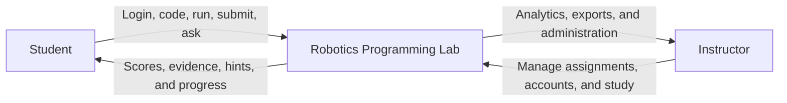
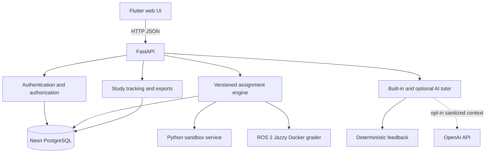

# Robotics Programming Lab

A local-first robotics education platform. Students complete Python and ROS 2
assignments in Flutter, FastAPI runs the assignment workflow, and test cases
remain the only grading authority. AI tutoring is optional and off by default.

This is the **staging repository**. Development and SQA happen here before an
approved release is promoted to the separate live repository.

## Quick start

Open a terminal in the repository root. Follow the
[first-time run chooser](docs/guides/FIRST_TIME_RUN.md), then use the guide for
[Windows](docs/guides/FIRST_TIME_RUN_WINDOWS.md) or
[Ubuntu](docs/guides/FIRST_TIME_RUN_UBUNTU.md). Both operating systems run the
same source, database schema, assignments, and graders.

### Windows PowerShell

Prepare this computer once, or after dependency changes:

```powershell
.\scripts\setup-local.ps1
```

Start the application:

```powershell
.\scripts\run-local.ps1 -FrontendPort 8180 -BackendPort 5100 -SandboxPort 5101
```

Open the frontend URL printed by the script, normally
`http://127.0.0.1:8180/app`. Keep the PowerShell window open.

Stop the application:

```powershell
.\scripts\stop-local.ps1
```

### Ubuntu Bash

```bash
./scripts/setup-local.sh
./scripts/run-local.sh --frontend-port 8180 --backend-port 5100 --sandbox-port 5101
./scripts/stop-local.sh
```

When `NEON_DATABASE_URL` exists in the ignored `local_handoff_package/.env`,
the launcher uses the shared `robotics_lab_staging` Neon database. It also
starts the local Python sandbox, FastAPI backend, and Flutter web app. Python
and Flutter generated files stay in this computer's local user-data
directories, outside the clone. AI remains off by default.

Use `-UseLocalPostgres` on Windows or `--use-local-postgres` on Ubuntu only for
an explicit offline/local-database run. Old dump files are retained as recovery
archives but are not updated while Neon is active.

### Use the same data on another computer

Copy the private `local_handoff_package` folder into the root of a fresh clone.
Its `.env` connects every authorized device to the same Neon staging database,
and `study_accounts.json` provides the optional file-based account importer.
Do not copy Python environments or Flutter build files. Never run concurrent
classroom tests from multiple devices unless that shared access is intentional.

## Prototype accounts

The staging database seeds these prototype accounts when it is initialized:

```text
Student:    student / student
Instructor: instructor / instructor
```

Change the credentials before a real classroom study. The login page does not
display them. Password login creates a normal persistent account session. The
separate **Try the student demo** button creates the temporary, non-persistent
demo session.

Instructors can manage student and instructor accounts from **Manage
accounts**. For file-based management without signing in, edit the ignored
`local_handoff_package/study_accounts.json`, then restart the backend or select
**Import study_accounts.json**. Set `active` to `false` instead of deleting an
account so its research history remains intact. Imported temporary passwords
are removed from the JSON after they are securely hashed in PostgreSQL.

## What is implemented

- Six configurable, versioned assignments: four Python and two ROS 2 exercises
- Test-case grading with server-only hidden evidence and maintained answers
- Student coding workspace, version-scoped local drafts, results, progressive
  hints, and study progress
- Instructor assignment, account, analytics, and research-export tools
- Server-side sessions and role authorization
- Shared Neon PostgreSQL with a dedicated staging database
- Optional local Docker PostgreSQL fallback with verified recovery dumps
- Explicit `-UseSqlite` fallback for disposable troubleshooting only
- Dedicated local Python sandbox and Docker-based ROS 2 grader
- Built-in tutoring plus optional OpenAI feedback that never changes grades
- Privacy-safe learning events, attempts, participant analytics, CSV, and Excel
  exports
- V5.2 Phase 1 research analytics with assignment-version summaries, active and
  elapsed completion time, paginated attempt history, classroom/participant/
  assignment catalogs, and instructor data-health checks

## Technology stack

| Layer | Technology | Purpose |
| --- | --- | --- |
| Interface | Flutter and Dart | Student and instructor web experience |
| API | Python 3.14, FastAPI, Uvicorn, Pydantic | Authentication, assignments, grading, tutoring, and research APIs |
| Persistence | SQLAlchemy, Alembic, PostgreSQL 17 | Versioned assignments, users, attempts, and study data |
| Python grading | Dedicated sandbox service | Bounded execution of untrusted Python submissions |
| ROS 2 grading | ROS 2 Jazzy Docker image | Builds packages and checks observable topic behavior |
| AI tutoring | Built-in tutor; optional OpenAI Responses API | Progressive feedback without grading or solution disclosure |
| Hosted interface | Flutter web and Vercel when promoted | Serves an approved release |
| Hosted API | Render when promoted | Runs the approved API and sandbox release |

## Application model



## Technical architecture



Flutter never grades submissions or stores protected answers. FastAPI loads
the exact assignment version, sends minimal code to the correct isolated
grader, stores structured evidence, and supplies only student-visible evidence
to the tutor. Browser drafts are tied to the assignment version, so code saved
for an older version is not silently reused after an instructor publishes a
newer assignment. Test cases remain the scoring authority.

## Repository map

```text
backend/              FastAPI app, data models, graders, assignments, and tests
frontend/             Flutter student and instructor interface
course_materials/     Controlled course sources plus a labeled history archive
manual_sqa_answers/   Maintained instructor answers for manual SQA
docs/                 Architecture, deployment, research, and SQA documents
  archive/             Superseded reports and deployment snapshots
scripts/              PowerShell and Bash setup, run, stop, and verification
local_handoff_package/ Ignored private Neon configuration and account import data
OS user-data folder    Generated Python, Flutter, logs, and runtime state
```

The documentation index is [docs/README.md](docs/README.md). Engineering and
security rules are in [AGENTS.md](AGENTS.md).

## AI option

AI is off by default. Normal grading and built-in hints do not require an API
key. To intentionally test optional AI feedback, place `OPENAI_API_KEY` in the
ignored `local_handoff_package/.env` file and start with:

```powershell
.\scripts\run-local.ps1 -EnableAi -FrontendPort 8180 -BackendPort 5100 -SandboxPort 5101
```

Provider failure or missing credit must not block grading. Hidden tests,
official solutions, secrets, and unrelated student data are excluded from the
AI context.

Ubuntu uses the equivalent command:

```bash
./scripts/run-local.sh --enable-ai --frontend-port 8180 --backend-port 5100 --sandbox-port 5101
```

## Verification

Run the complete local gate from the repository root:

```powershell
.\scripts\verify-local.ps1 -ApiBaseUrl http://127.0.0.1:5100
```

On Ubuntu:

```bash
./scripts/verify-local.sh --api-base-url http://127.0.0.1:5100
```

It checks fresh-clone completeness, then runs backend tests, dependency checks, Python compilation, Flutter analysis
and tests, a release web build from LocalAppData, an isolated PostgreSQL
backup/restore and simulated-device-lock test, Git whitespace validation, and
a dry-run validation of the safe cleanup allow-list. It also checks managed
service health when the stack is running.

Check the three local services manually when using the example ports:

```powershell
Invoke-WebRequest -UseBasicParsing http://127.0.0.1:8180/app
Invoke-RestMethod http://127.0.0.1:5100/health
Invoke-RestMethod http://127.0.0.1:5101/health
```

For ROS 2 validation:

```powershell
.\scripts\check-ros2-local.ps1
```

On Ubuntu, use `./scripts/check-ros2-local.sh`; add `--build` only for the
first build or after ROS image inputs change.

## Safe local cleanup

Preview rebuildable local artifacts from the repository root:

```powershell
.\scripts\clean-local.ps1
```

After stopping the application, remove only that fixed allow-list:

```powershell
.\scripts\stop-local.ps1
.\scripts\clean-local.ps1 -Execute
```

The cleanup script protects databases, PostgreSQL backups, generated
PDF outputs, course materials, instructor answers, and Git history. Flutter and
Python regenerate the removed caches during the next setup, test, or run.

## Advanced configuration

Local staging uses the shared `robotics_lab_staging` database in Neon whenever
`NEON_DATABASE_URL` is present in `local_handoff_package/.env`. The database
name is derived safely, so the older `neondb` database remains separate and
untouched. Use Neon's dashboard or SQL editor for authorized inspection and
backup controls.

Use `-UseLocalPostgres` or `--use-local-postgres` for an intentional offline
Docker PostgreSQL run. That fallback retains the verified dump and device-lock
workflow. Use `-UseSqlite` only for disposable troubleshooting. The ignored
handoff folder remains private because it contains the Neon connection string,
optional OpenAI key, and editable account-import file.

Copy `backend/.env.example` to ignored `local_handoff_package/.env` only when
you need optional settings. Production deployment, study-account import, API details, and
research-data contracts are documented under `docs/` and `backend/README.md`.

Never commit `.env`, databases, credentials, API keys, Python environments,
logs, or generated Flutter output. Do not promote staging to the live
repository until the complete SQA gate passes and the project owner approves
the exact commit.
