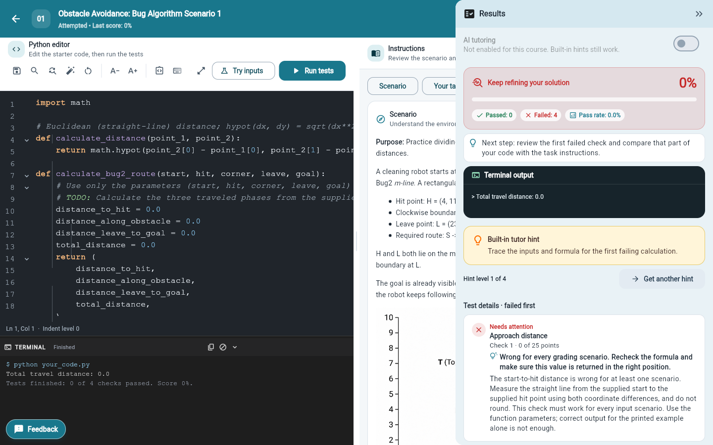
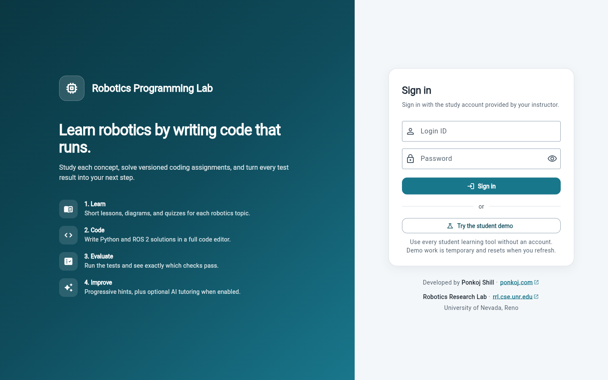
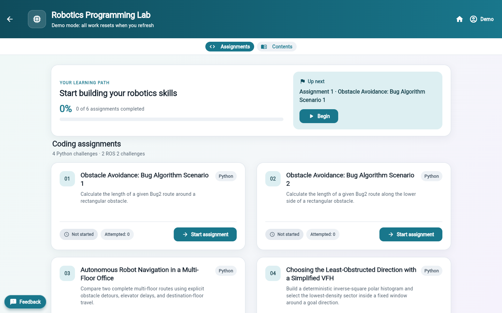
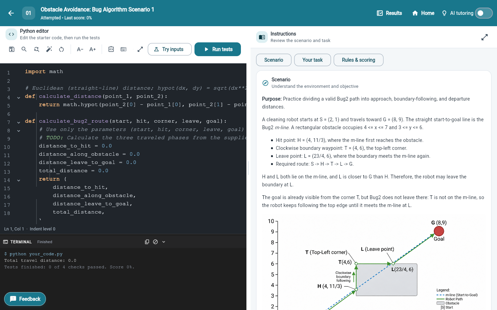
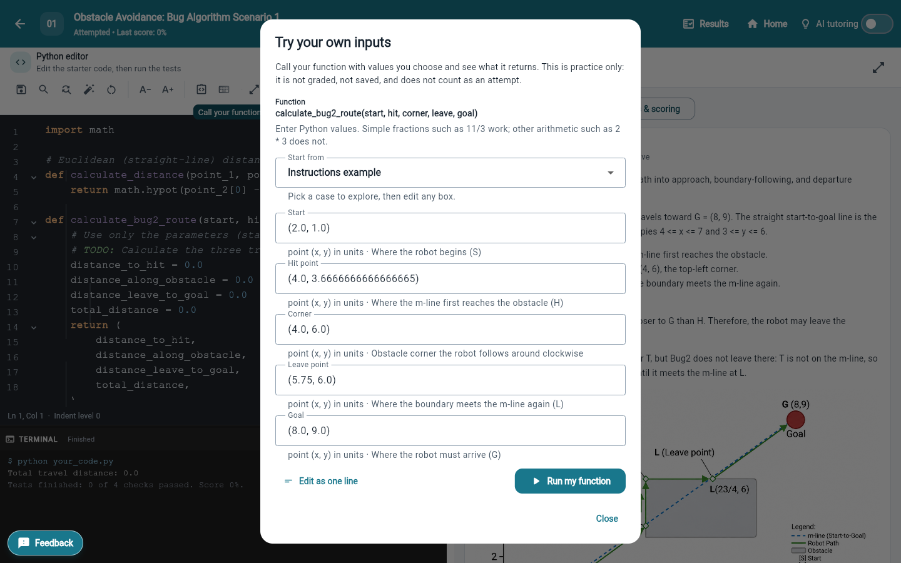
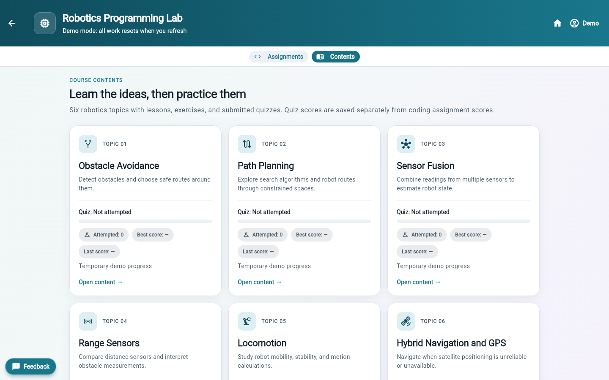
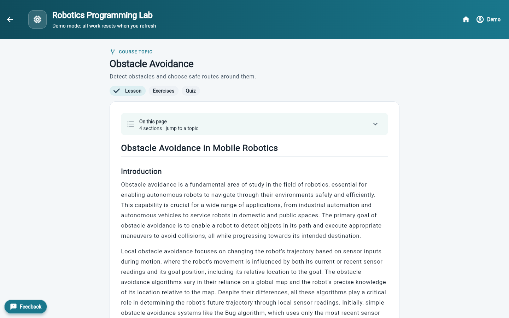
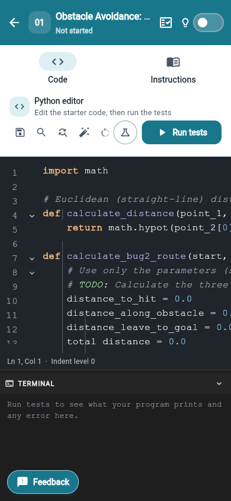
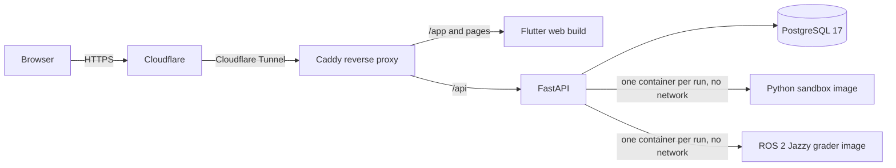

# Robotics Programming Lab

[](https://rpl.ponkoj.com/app)

A classroom and research platform for robotics programming. Students read
short lessons, take topic quizzes, and complete versioned Python and ROS 2
assignments in the browser. Every submission is graded by test cases on the
server. Instructors manage assignments and accounts and review privacy-safe
research analytics. AI tutoring is optional and off by default.

**Live site:** <https://rpl.ponkoj.com/app>

This is the **live repository**: `main` is the release currently running at
the address above. New work is developed and checked in a separate staging
repository first.



## Tour

Screenshots are from the live site using **Try the student demo**.

| | |
|---|---|
|  |  |
| **Sign in or try the demo.** No account needed for the demo, and nothing is saved. | **Home.** A learning path, progress, and the six assignments. |
|  |  |
| **Instructions beside the code.** Scenario, task, and rules with to-scale diagrams. | **Try inputs.** Call your own function with chosen values. Not graded or saved. |
|  |  |
| **Course contents.** Six topics, each with a lesson, exercises, and a quiz. | **Lessons.** Readable pages with a jump-to-section menu. |

<p align="center">
  <br>
  <em>The same workspace on a phone: Code and Instructions tabs, terminal under the editor.</em>
</p>

## What it does

- **Six assignments:** four Python exercises (Bug algorithm routes, multi-floor
  office navigation, a simplified Vector Field Histogram) and two ROS 2 Jazzy
  exercises (drive and stop, stop for an obstacle).
- **Test-case grading:** public and server-only hidden checks, with structured
  feedback and partial credit where the instructions state it. Grades never
  depend on AI.
- **Student workspace:** code editor with formatting, completion, and
  search/replace; a terminal under the editor with printed output, errors
  linked to the failing line, and a test summary; a Results panel;
  progressive built-in hints; and drafts saved per assignment version.
- **Try inputs playground:** students call their own function with labelled
  inputs (ungraded, never saved) and see a to-scale route map or a polar VFH
  view of the result.
- **Course content:** six topics with lessons, diagrams, exercises, and one
  10-question quiz each. Quizzes are graded on the server and stored
  separately from assignment scores.
- **Instructor Studio:** assignment management and publishing, account management with per-account sign-in history,
  assignment-version analytics, data-health checks, and CSV/Excel research
  exports that use participant codes instead of login IDs.
- **Student demo:** a **Try the student demo** button opens a temporary,
  memory-only session. Refreshing the page resets it and nothing is saved.

## How it runs



| Part | Technology | Role |
|---|---|---|
| Interface | Flutter web (Dart) | Student and instructor screens |
| API | Python 3.14, FastAPI, Uvicorn, Pydantic | Sign-in, assignments, grading, tutoring, research |
| Data | SQLAlchemy, Alembic, PostgreSQL 17 | Accounts, versioned assignments, attempts, study data |
| Python grading | Docker sandbox image | Runs each untrusted submission with no network and strict limits |
| ROS 2 grading | ROS 2 Jazzy Docker image | Builds the student package and checks its topic behavior |
| Public access | Cloudflare Tunnel and Caddy | HTTPS at one address, with the API under `/api` |
| Tutoring | Built-in hints; optional OpenAI | Feedback that never changes grades or reveals solutions |

The live instance is self-hosted on a dedicated machine. The web app and API
listen only on that machine. Cloudflare Tunnel makes an outbound connection,
so no inbound ports are open. The browser never grades code or receives hidden
tests or official solutions.

## Run it locally

Local development connects to a private Neon staging database and needs a
private `.env` file, so it is meant for authorized contributors. Follow the
[first-time run guide](docs/guides/FIRST_TIME_RUN.md), then the guide for
[Windows](docs/guides/FIRST_TIME_RUN_WINDOWS.md) or
[Ubuntu](docs/guides/FIRST_TIME_RUN_UBUNTU.md).

```powershell
.\scripts\setup-local.ps1   # once, or after dependency changes
.\scripts\run-local.ps1     # opens http://127.0.0.1:8180/app
.\scripts\stop-local.ps1
```

Ubuntu uses `./scripts/setup-local.sh`, `./scripts/run-local.sh`, and
`./scripts/stop-local.sh`.

The self-hosted live stack is started with `scripts/run-live.ps1` and stopped
with `scripts/stop-live.ps1`. It requires `ENVIRONMENT=production` and
`SELF_HOSTED_DATABASE=true` in the machine's private `.env`; see
`backend/.env.example`.

## Verification

```powershell
.\scripts\verify-local.ps1
```

This runs the backend test suite, dependency and compile checks, Flutter
analysis, tests, and a release web build. `scripts/run-browser-tests.ps1`
drives the student demo and an instructor session in a real browser, and
`scripts/check-ros2-local.ps1` checks the ROS 2 grader.

## Security and privacy

- Hidden tests, official solutions, and grader secrets stay on the server.
- Every submission is treated as hostile and runs in an isolated container.
- Student identity comes from the server session, never from the browser.
- Production refuses wildcard CORS, SQLite, automatic schema creation, and
  default or short account passwords.
- Research exports exclude passwords, tokens, and submitted source code.
- Secrets live only in an ignored `.env` file and are never committed.

## Repository map

```text
backend/              FastAPI app, models, graders, assignments, migrations, tests
frontend/             Flutter student and instructor interface
course_materials/     Course source documents
docs/                 Architecture, deployment, research, and QA records
scripts/              Setup, run, stop, live hosting, and verification scripts
```

More detail: the [system architecture blueprint](docs/system-architecture/PRD.md)
(PRD, app flow, UI spec, technical requirements, data schema, and plan),
the [documentation index](docs/README.md),
[backend notes](backend/README.md), and the engineering rules in
[AGENTS.md](AGENTS.md).
