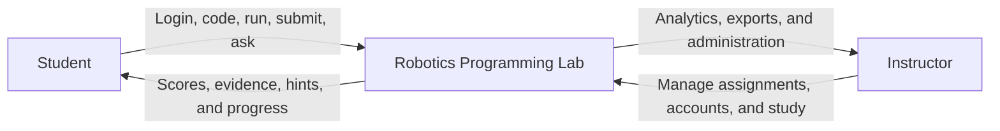
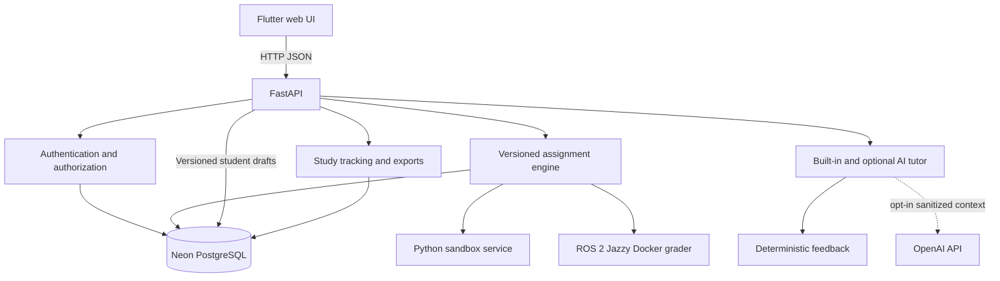

# Robotics Programming Lab

A robotics education platform with a local development workflow and shared
Neon data. Students complete Python and ROS 2
assignments in Flutter, FastAPI runs the assignment workflow, and test cases
remain the only grading authority. AI tutoring is optional and off by default.

This is the **staging repository**. Development and SQA happen here before an
approved release is promoted to the separate live repository.

All QA checklists, defects, dated results, and historical evidence are maintained
in the [single master QA workbook](docs/sqa/Robotics_Programming_Lab_Master_SQA_Checklist.xlsx).

## Quick start

Open a terminal in the repository root. Follow the
[first-time run chooser](docs/guides/FIRST_TIME_RUN.md), then use the guide for
[Windows](docs/guides/FIRST_TIME_RUN_WINDOWS.md) or
[Ubuntu](docs/guides/FIRST_TIME_RUN_UBUNTU.md). Both operating systems run the
same source, database schema, assignments, and graders.

### Windows PowerShell

Prepare this computer once, or after dependency changes:

```powershell
.\scripts\setup-local.ps1
```

Start the application:

```powershell
.\scripts\run-local.ps1 -FrontendPort 8180 -BackendPort 5100 -SandboxPort 5101
```

Open the frontend URL printed by the script, normally
`http://127.0.0.1:8180/app`. Keep the PowerShell window open.

The launcher builds and serves the same optimized Flutter release bundle that
Vercel deploys, so pages load quickly. Frontend developers who need hot reload
can add `-DebugFrontend` (Ubuntu: `--debug-frontend`) to serve the slower debug
build instead.

Stop the application:

```powershell
.\scripts\stop-local.ps1
```

### Ubuntu Bash

```bash
./scripts/setup-local.sh
./scripts/run-local.sh --frontend-port 8180 --backend-port 5100 --sandbox-port 5101
./scripts/stop-local.sh
```

The launcher requires `NEON_DATABASE_URL` in the ignored
repository-root `.env` and uses the shared `robotics_lab_staging` Neon database.
It also
starts the local Python sandbox, FastAPI backend, and Flutter web app. Python
and Flutter generated files stay in this computer's local user-data
directories, outside the clone. AI remains off by default.

### Use the same data on another computer

Every authorized backend connects to the same Neon database. A local backend
still needs a securely provisioned private `.env`; Git intentionally does not
distribute database or OpenAI credentials. A future hosted staging backend
removes that per-device secret requirement because local Flutter clients need
only its public HTTPS URL.

Internet access is required for saved data. A missing or unavailable Neon
connection stops database-dependent operations; the app never switches to a
local database. Direct backend starts and Alembic migrations use the same Neon
configuration as the launchers. Do not add a local `DATABASE_URL` override.

The Neon-only migration follows four steps: inventory old databases, reconcile
their record IDs and history, disable local fallback, and verify shared access
before publication. The desktop audit found both legacy PostgreSQL databases
and six archived dumps already represented in Neon, so no duplicate import was
needed. Newer Neon account and assignment settings were preserved. Evidence is
in the master QA workbook. Unavailable files on other devices cannot be checked
from this desktop.

## Prototype accounts

When a database is initialized, the backend seeds two prototype accounts,
`student` and `instructor`. Their passwords come from `DEMO_STUDENT_PASSWORD`
and `DEMO_INSTRUCTOR_PASSWORD` in the ignored repository-root `.env`; set
strong values there before initializing a new database, and share them only
through the approved private channel. Seeding never changes an existing
account, so change a password on a shared database through **Manage
accounts**. Production refuses to start with the built-in defaults or any demo
password shorter than 12 characters. The login page does not display
credentials. Password login creates a normal persistent account session. The
separate **Try the student demo** button creates the temporary, non-persistent
demo session.

Instructors can manage student and instructor accounts from **Manage
accounts**. The password-free roster is tracked at
`backend/data/study_accounts.json`, so every Git clone receives the same account
IDs, roles, and active flags. Password creation and reset must be performed in
Instructor Studio; password hashes remain only in Neon. Set `active` to `false`
instead of deleting an account so its research history remains intact.

## What is implemented

- Six post-login course topics with browser-readable lessons, diagrams,
  question-only exercises, math practice, and one 10-question quiz per topic.
  Open **Contents** from the assignment home page. Students submit a complete
  quiz to see a score; their quiz attempts are saved in PostgreSQL separately
  from coding-assignment grades. Demo and instructor previews are not saved.
  Quiz answer keys stay on the backend.
- Six configurable, versioned assignments: four Python and two ROS 2 exercises
- Test-case grading with server-only hidden evidence and maintained answers
- Try inputs playground: students call their own function with chosen inputs
  (ungraded, never saved) and see a to-scale route map (Assignments 1-3) or a
  polar VFH view (Assignment 4) drawn from their inputs and returned values
- Student coding workspace with cross-device version-scoped drafts, manual
  Python formatting, completion help, search/replace, results, progressive
  hints, and study progress
- Instructor assignment, account, analytics, and research-export tools
- Server-side sessions and role authorization
- Shared Neon PostgreSQL with a dedicated staging database
- Dedicated local Python sandbox and Docker-based ROS 2 grader
- Built-in tutoring plus optional OpenAI feedback that never changes grades
- Privacy-safe learning events, attempts, participant analytics, CSV, and Excel
  exports
- V5.2 Phase 1 research analytics with assignment-version summaries, active and
  elapsed completion time, paginated attempt history, classroom/participant/
  assignment catalogs, and instructor data-health checks

Assignment checks cover varied function inputs, not only the printed example.
Assignment 3 selects the service elevator when complete route times tie.
Assignment 4 tests variable sector counts, supplied readings, and density ties;
it does not require angle wrapping. Assignment 5 measures the stop interval
from the first observed command, excluding node-launch delay, and requires
continued stop commands throughout the observation period. Assignment 6
checks the exact stopping threshold, neighboring distances, mixed invalid
readings, empty scans, and recovery. ROS package/node scaffold checks can earn
partial credit before movement behavior is implemented; the instructions show
the individual weights.

Course pages are generated from `course_materials/content` and stored in
`backend/course_content`. The `References` folders and solution files are not
published as student pages. After reviewing a source-document edit, install
`scripts/requirements-course-content.txt` in a separate content-authoring
Python environment and run `python scripts/build_course_content.py` from the
repository root. The running backend does not need this authoring dependency.

## Technology stack

| Layer | Technology | Purpose |
| --- | --- | --- |
| Interface | Flutter and Dart | Student and instructor web experience |
| API | Python 3.14, FastAPI, Uvicorn, Pydantic | Authentication, assignments, grading, tutoring, and research APIs |
| Persistence | SQLAlchemy, Alembic, PostgreSQL 17 | Versioned assignments, users, attempts, and study data |
| Python grading | Dedicated sandbox service | Bounded execution of untrusted Python submissions |
| ROS 2 grading | ROS 2 Jazzy Docker image | Builds packages and checks observable topic behavior |
| AI tutoring | Built-in tutor; optional OpenAI Responses API | Progressive feedback without grading or solution disclosure |
| Hosted interface | Flutter web and Vercel when promoted | Serves an approved release |
| Hosted API | Render when promoted | Runs the approved API and sandbox release |

## Application model



## Technical architecture



Flutter never grades submissions or stores protected answers. FastAPI loads
the exact assignment version, sends minimal code to the correct isolated
grader, stores structured evidence, and supplies only student-visible evidence
to the tutor. Persistent student drafts are stored in PostgreSQL and tied to
the assignment version, with a browser fallback during connectivity problems.
Code saved for an older version is never silently reused after an instructor
publishes a newer assignment. Demo drafts remain temporary. Test cases remain
the scoring authority.

## Repository map

```text
backend/              FastAPI app, data models, graders, assignments, and tests
frontend/             Flutter student and instructor interface
course_materials/     Controlled course sources plus a labeled history archive
assignments_answers/  Maintained instructor answers for manual SQA
docs/                 Architecture, deployment, research, and SQA documents
  archive/             Superseded reports and deployment snapshots
scripts/              PowerShell and Bash setup, run, stop, and verification
.env                  Ignored private Neon and optional AI configuration
OS user-data folder    Generated Python, Flutter, logs, and runtime state
```

The documentation index is [docs/README.md](docs/README.md). Engineering and
security rules are in [AGENTS.md](AGENTS.md).

## AI option

AI is off by default. Normal grading and built-in hints do not require an API
key. If `OPENAI_API_KEY` is in the ignored repository-root `.env` file, the
normal local launcher makes AI available without making an API request. Turn on
**AI tutoring** in an assignment to use it; the switch starts off. The optional
`-EnableAi` flag now only checks that a key is configured before starting:

```powershell
.\scripts\run-local.ps1 -EnableAi -FrontendPort 8180 -BackendPort 5100 -SandboxPort 5101
```

On Ubuntu, `--enable-ai` performs the same optional startup check. Neither
flag is needed to make the assignment switch work when a key is configured.
Provider failure or missing credit must not block grading. Hidden tests,
official solutions, secrets, and unrelated student data are excluded from the
AI context.

Results opens in a separate, minimizable panel. You can open it before the
first run; running tests opens it automatically. Results is an isolated
right-side overlay panel on desktop and narrow screens, never a bottom dock.
Opening it does not resize the instruction area. Minimize it and reopen using
the Results button without losing the current result. With AI off, results show
test evidence and available built-in hints without contacting OpenAI. Tutor
questions require a completed test run because they use that attempt's
evidence.

One design system in `frontend/lib/theme/app_theme.dart` styles every screen:
a teal brand, slate neutrals, white cards with soft shadows, and a reserved
violet that always marks AI-generated feedback with an **AI-generated** badge.
The sign-in page explains the Learn, Code, Evaluate, Improve loop. The student
home opens with a learning-path summary and an **Up next** action for the
first unfinished assignment; assignment cards show a Python or ROS 2 tag, best
and last scores, attempts, and Start/Continue/Review actions. Instructions
have section jump buttons; lessons with multiple headings have an expandable
**On this page** navigator. These presentation changes do not alter grading,
quiz persistence, assignment versions, or research calculations.

Ubuntu's optional startup-check command is:

```bash
./scripts/run-local.sh --enable-ai --frontend-port 8180 --backend-port 5100 --sandbox-port 5101
```

## Verification

Run the complete local gate from the repository root:

```powershell
.\scripts\verify-local.ps1 -ApiBaseUrl http://127.0.0.1:5100
```

On Ubuntu:

```bash
./scripts/verify-local.sh --api-base-url http://127.0.0.1:5100
```

It checks source completeness, private Neon configuration, backend tests,
dependency integrity, Python compilation, Flutter analysis and tests, a release
web build from LocalAppData, Git whitespace, and the safe cleanup allow-list.
It also checks managed service health when the stack is running.

### Browser tests

With the stack running, drive the student and instructor flows in a real
browser:

```powershell
.\scripts\run-browser-tests.ps1 -InstructorLogin <instructor-login>
```

On Ubuntu: `./scripts/run-browser-tests.sh --instructor-login <instructor-login>`.

The student test uses the memory-only demo: it runs Assignment 1's starter
code, checks the failing result and built-in hint, submits the maintained
answer, expects every test to pass, and confirms that a refresh resets the
demo. The instructor test signs in, checks the studio and research dashboard,
and signs out without changing course or research data (sign-in and sign-out
still record the normal session and audit rows). The script asks for the instructor
password (or reads `E2E_INSTRUCTOR_PASSWORD`); without `-InstructorLogin` the
instructor test is skipped. Playwright runs in its own environment under the OS
user-data folder; Windows uses the installed Google Chrome and Ubuntu downloads
Playwright's Chromium.

Check the three local services manually when using the example ports:

```powershell
Invoke-WebRequest -UseBasicParsing http://127.0.0.1:8180/app
Invoke-RestMethod http://127.0.0.1:5100/health
Invoke-RestMethod http://127.0.0.1:5101/health
```

For ROS 2 validation:

```powershell
.\scripts\check-ros2-local.ps1
```

On Ubuntu, use `./scripts/check-ros2-local.sh`; add `--build` only for the
first build or after ROS image inputs change.

## Safe local cleanup

Preview rebuildable local artifacts from the repository root:

```powershell
.\scripts\clean-local.ps1
```

After stopping the application, remove only that fixed allow-list:

```powershell
.\scripts\stop-local.ps1
.\scripts\clean-local.ps1 -Execute
```

The cleanup script protects private configuration, generated PDF outputs,
course materials, instructor answers, and Git history. Flutter and Python
regenerate the removed caches during the next setup, test, or run.

## Advanced configuration

Local staging always uses the shared `robotics_lab_staging` Neon database. The
database name is derived safely from `NEON_DATABASE_URL`, so the older `neondb`
database remains separate and untouched. Use Neon's dashboard or SQL editor
for authorized inspection, monitoring, and backup controls. Local PostgreSQL
and runtime SQLite database modes are no longer supported.

The ignored repository-root `.env` contains the Neon/OpenAI environment settings.
The password-free account roster is tracked in Git.

Copy `backend/.env.example` to ignored `.env` only when you need to create the
private settings file. Production deployment, study-account import, API details, and
research-data contracts are documented under `docs/` and `backend/README.md`.

Never commit `.env`, databases, credentials, API keys, Python environments,
logs, or generated Flutter output. Do not promote staging to the live
repository until the complete SQA gate passes and the project owner approves
the exact commit.
