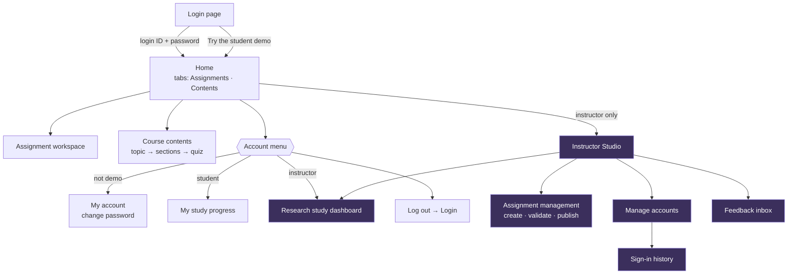
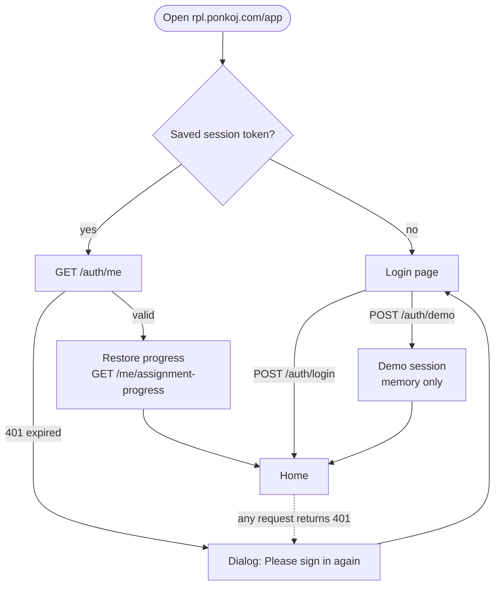
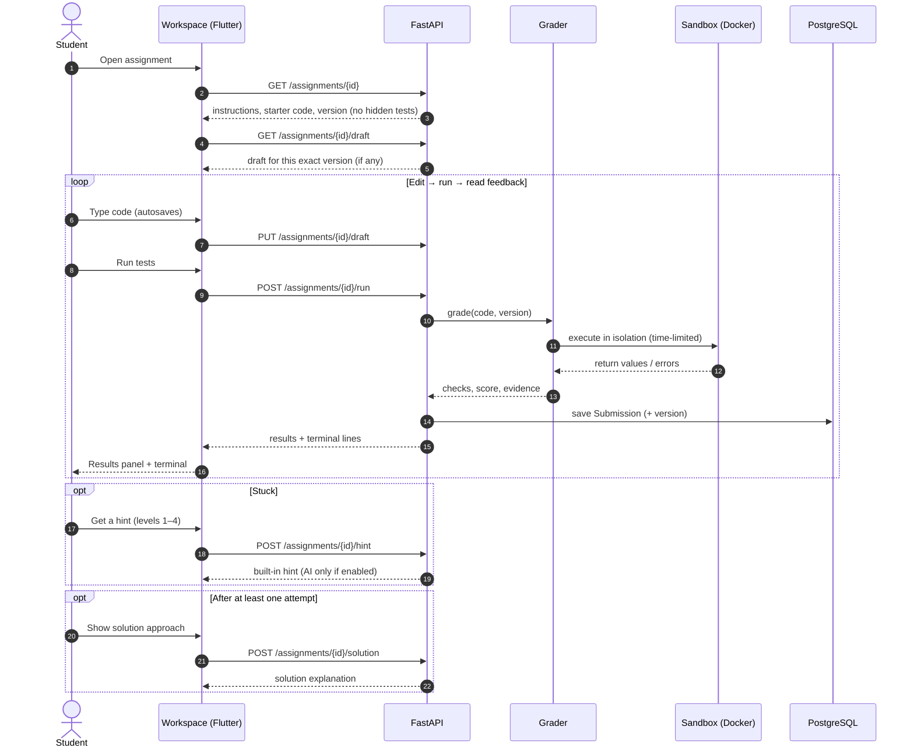
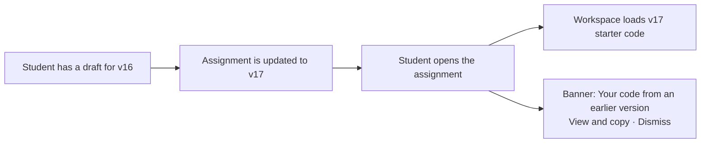
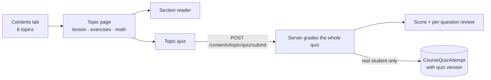
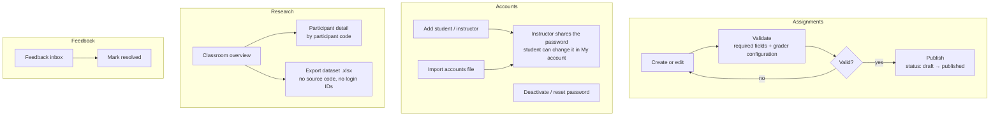
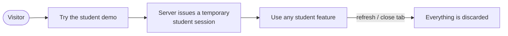

# 02 · AppFlow — How People Move Through the App

> **What this file answers:** *Which screens exist, how does a user get from one to the next, and what happens at each step?*
> Layer 1 of the system blueprint, read together with [PRD.md](PRD.md).
>
> | Blueprint | [PRD](PRD.md) · [AppFlow](AppFlow.md) · [UI_Spec](UI_Spec.md) · [TRD](TRD.md) · [Schema](Schema.md) · [Plan](Plan.md) |
> |---|---|
> | Describes | Live release `3571938b` |
> | Last reviewed | 2026-10-26 |

---

## 1. Site map

Everyone lands on the same **Home** page (`AssignmentListPage`). The account
menu and the Instructor Studio button change with the role.

> 🟪 Purple screens are instructor-only. The server enforces this on every
> `/admin/*` route; hiding the button is only cosmetic.

## 2. Sign-in and session

| Rule | Behaviour |
|---|---|
| Session length | 12 hours (`AUTH_SESSION_HOURS`) |
| Expired mid-work | A dialog appears once, then the app returns to login. Local drafts are kept |
| Demo refresh | Returns to login and wipes all demo state |
| Logout | Revokes the server session and stops research tracking |

## 3. Core student loop: solve an assignment

This is the most important flow in the product.

### Workspace actions at a glance

| Action | API | Graded? | Saved? |
|---|---|---|---|
| **Run tests** | `POST /assignments/{id}/run` | ✅ | ✅ Submission row |
| **Submit** | `POST /assignments/{id}/submit` | ✅ | ✅ Submission row |
| **Try inputs** | `POST /assignments/{id}/playground` | ❌ | ❌ |
| **Format Python** | `POST /assignments/{id}/format` | ❌ | ❌ |
| **Save draft** (auto) | `PUT /assignments/{id}/draft` | ❌ | ✅ CodeDraft row |
| **Get a hint** | `POST /assignments/{id}/hint` | ❌ | ✅ HintInteraction row (needs an earlier run) |
| **Show solution** | `POST /assignments/{id}/solution` | ❌ | ✅ research event (needs an earlier run) |

> Demo sessions get the same responses, but none of the ✅ rows are written.

### When the assignment version changes

The older draft is never loaded into the newer workspace automatically.

## 4. Course contents and quiz

The answer keys stay in `backend/course_content/quiz_answers.json`. Demo and
instructor previews are not stored.

## 5. Instructor flows

## 6. Demo flow (public visitors)

The demo writes **no** auth, submission, hint, audit, quiz or research rows.
Each browser's demo is isolated from every other session.
