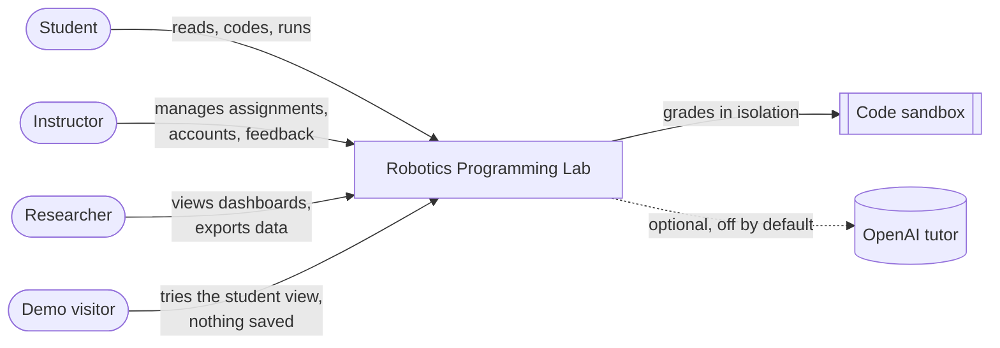

# 01 · PRD — Product Requirements

> **What this file answers:** *What is the product, who is it for, and what must it do?*
> Layer 1 of the system blueprint, read together with [AppFlow.md](AppFlow.md).
>
> | Blueprint | [PRD](PRD.md) · [AppFlow](AppFlow.md) · [UI_Spec](UI_Spec.md) · [TRD](TRD.md) · [Schema](Schema.md) · [Plan](Plan.md) |
> |---|---|
> | Describes | Live release `3571938b` at https://rpl.ponkoj.com |
> | Last reviewed | 2026-10-26 |

---

## 1. Product in one paragraph

**Robotics Programming Lab (RPL)** is a web lab where students learn robotics
programming by reading short lessons, taking topic quizzes, and solving
versioned coding assignments in the browser. Each run is graded on the
server in an isolated sandbox, and students get immediate, structured
feedback and built-in hints. Instructors manage assignments and accounts, and
researchers study how students learn through privacy-safe, version-exact data.

## 2. Users and their goals

| User | Main goal | What they can do |
|---|---|---|
| **Student** | Learn and pass assignments | Read lessons, take quizzes, write code, run tests, try inputs, get hints, reveal the solution approach after an attempt, see their own progress |
| **Instructor** | Run the course | Everything a student sees, plus create/validate/publish assignments, manage student and instructor accounts, read page feedback, view sign-in history and the research dashboard |
| **Researcher** (an instructor role today) | Study learning behaviour | Classroom overview, per-participant detail by participant code, exact-version analytics, privacy-safe export |
| **Demo visitor** | Try the student experience | A temporary student session. Nothing is stored, and a refresh returns to login |

## 3. Problems the product solves

1. Students cannot easily see *why* robotics code is wrong. **RPL** gives
   structured feedback that names the failed check and the student's own line.
2. Students need practice without a robot. **RPL** grades plain Python and ROS 2
   code against scenarios, all inside the browser.
3. Instructors need a repeatable assignment format. **RPL** uses one generic
   assignment workflow driven by configuration and grader modules.
4. Research needs trustworthy data. **RPL** saves the exact assignment version
   with every attempt and keeps raw events append-only.

## 4. Core features

Status key: ✅ live · 🟡 built but switched off · ⬜ not built

| # | Feature | Status | Notes |
|---|---|---|---|
| F1 | Sign-in with login ID and password | ✅ | Server sessions last 12 h. A sign-in that has expired shows a "Please sign in again" dialog |
| F2 | Student demo (memory-only) | ✅ | Server-issued temporary session. It writes no auth, submission, hint, audit or research rows |
| F3 | Course contents: lessons, exercises, quizzes | ✅ | 6 topics. Whole quizzes are graded on the server |
| F4 | Assignment list with progress | ✅ | Best and latest score, attempt count, restored from the server at sign-in |
| F5 | Assignment workspace: instructions, editor, terminal, results | ✅ | See [UI_Spec](UI_Spec.md) |
| F6 | Run tests (graded, saved) | ✅ | Python sandbox or ROS 2 container |
| F7 | Try inputs (not graded, not saved) | ✅ | Call your function with your own values, including fractions |
| F8 | Built-in hints (4 levels) | ✅ | Deterministic, works with AI off |
| F9 | Reveal solution approach | ✅ | Only after a run or submit of the same version |
| F10 | Draft autosave per assignment version | ✅ | A draft from an earlier version is kept in a separate banner, never loaded into a newer workspace |
| F11 | Page feedback button and instructor inbox | ✅ | |
| F12 | Instructor Studio: create, validate, publish | ✅ | |
| F13 | Account management and CSV import | ✅ | |
| F14 | Research dashboard and export | ✅ | Uses participant codes, never login IDs, and never exports source code |
| F15 | AI tutor | 🟡 | Code is in place. Off by default, and no API key is set on live |
| F16 | Self-service password reset and email | 🟡 | Behind feature flags |
| F17 | Mobile app (Android/iOS) | ⬜ | Out of scope for now |

## 5. Assignment inventory (live)

| # | Stable ID | Version | Topic | Grader |
|---|---|---|---|---|
| 1 | `robotics-assignment-1` | 17 | Bug algorithm, scenario 1 | `python_function` |
| 2 | `robotics-assignment-2` | 16 | Bug algorithm, scenario 2 | `python_function` |
| 3 | `robotics-assignment-3` | 18 | Multi-floor office navigation | `python_function` |
| 4 | `robotics-assignment-4` | 16 | Simplified VFH direction choice | `python_function` |
| 5 | `ros2-drive-forward` | 12 | Drive forward and stop (ROS 2) | `ros2_topic` |
| 6 | `ros2-obstacle-stop` | 12 | Stop for an obstacle (ROS 2) | `ros2_topic` |

## 6. Product rules (must always hold)

> These are the non-negotiables from [AGENTS.md](../../AGENTS.md). A change that breaks one is a release blocker.

- 🔒 Hidden tests, official solutions and answer keys **never leave the server**.
- 🧾 Every attempt stores its **exact assignment version**.
- 📝 Drafts are scoped to **assignment ID + version**.
- 🧑‍🎓 Student identity comes from the **server session**, never from the client.
- 🤖 AI is **optional and off by default**. Grading, hints and submissions never depend on it.
- 🧪 The demo is **memory-only and student-only**.
- 🧱 There is **one generic assignment workflow**, with no assignment-specific screens.

## 7. Out of scope (for now)

- Mobile-store apps and Android packaging.
- Live robot hardware or 3D simulation in the browser.
- Self-service sign-up. Accounts are created by instructors.
- AI tutoring in a real study, until evaluation cases are approved.

## 8. How we know it works

| Measure | Target |
|---|---|
| Correct answer passes, starter code fails with a teaching message | Every assignment, every version |
| Run result shown | Within the sandbox time limit (5 s Python, 30 s ROS 2) plus overhead |
| Data integrity | 0 attempts without a version, 0 leaked hidden tests or solutions |
| Availability without AI | 100 % of core features |
| Automated tests | Backend and frontend suites green in CI |

## 9. Open questions for the owner

- [ ] Should a separate **Researcher** role exist, apart from Instructor?
- [ ] When should the **AI tutor** be turned on for a study, and with which model?
- [ ] Are more **ROS 2 assignments** planned after 5 and 6?
- [ ] Should students see a **class leaderboard** or only their own progress?
