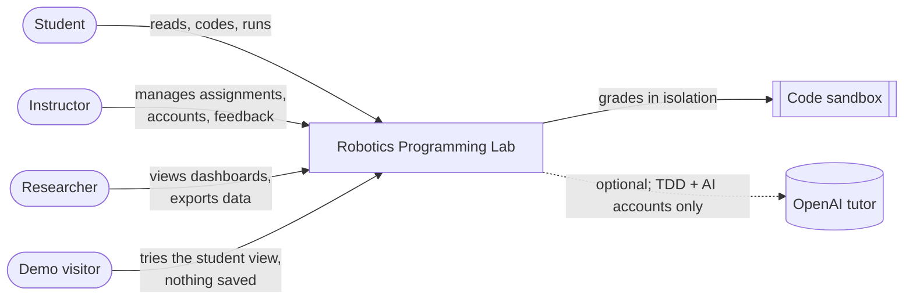

# 01 · PRD — Product Requirements

> **What this file answers:** *What is the product, who is it for, and what must it do?*
> Layer 1 of the system blueprint, read together with [AppFlow.md](AppFlow.md).
>
> | Blueprint | [PRD](PRD.md) · [AppFlow](AppFlow.md) · [UI_Spec](UI_Spec.md) · [TRD](TRD.md) · [Schema](Schema.md) · [Plan](Plan.md) |
> |---|---|
> | Describes | Live release `a69b89b3` at https://rpl.ponkoj.com |
> | Last reviewed | 2026-11-20 |

---

## 1. Product in one paragraph

**Robotics Programming Lab (RPL)** is a web lab where students learn robotics
programming by reading short lessons, taking topic quizzes, and solving
versioned coding assignments in the browser. Each run is graded on the
server in an isolated sandbox, and students get immediate, structured
feedback and built-in hints. Instructors manage assignments and accounts and
assign each student one of three feedback modes (Traditional, TDD, TDD + AI)
for the study, and researchers study how students learn through
privacy-safe, version-exact data.

## 2. Users and their goals

| User | Main goal | What they can do |
|---|---|---|
| **Student** | Learn and pass assignments | Read lessons, take quizzes, write code, run tests, try inputs, get hints (TDD + AI mode), see their own progress; the solution approach is for the demo and instructors only |
| **Instructor** | Run the course | Everything a student sees (always with every feedback tool), plus create/validate/publish assignments, manage student and instructor accounts, set each student's feedback mode, switch the AI tutor on, read page feedback, view sign-in history and the research dashboard |
| **Researcher** (an instructor role today) | Study learning behaviour | Classroom overview, per-participant detail by participant code, exact-version analytics, privacy-safe export |
| **Demo visitor** | Try the student experience | A temporary student session. Nothing is stored, and a refresh returns to login |

## 3. Problems the product solves

1. Students cannot easily see *why* robotics code is wrong. **RPL** gives
   structured feedback that names the failed check and the student's own line.
2. Students need practice without a robot. **RPL** grades plain Python and ROS 2
   code against scenarios, all inside the browser.
3. Instructors need a repeatable assignment format. **RPL** uses one generic
   assignment workflow driven by configuration and grader modules.
4. Research needs trustworthy data. **RPL** saves the exact assignment version
   with every attempt and keeps raw events append-only.

## 4. Core features

Status key: ✅ live · 🟡 built but switched off · ⬜ not built

| # | Feature | Status | Notes |
|---|---|---|---|
| F1 | Sign-in with login ID and password | ✅ | Server sessions last 12 h. A sign-in that has expired shows a "Please sign in again" dialog |
| F2 | Student demo (memory-only) | ✅ | Server-issued temporary session. It writes no auth, submission, hint, audit or research rows |
| F3 | Course contents: lessons, exercises, quizzes | ✅ | ROS 2 for Mobile Robots (pre-test, lesson, exercises, math, quiz), plus 6 earlier topics under Old contents. Whole quizzes are graded on the server; the first attempt is the quiz score and the pre-test is one attempt |
| F4 | Assignment list with progress | ✅ | Best and latest score, attempt count, restored from the server at sign-in |
| F5 | Assignment workspace: instructions, editor, terminal, results | ✅ | See [UI_Spec](UI_Spec.md) |
| F6 | Run tests (graded, saved) | ✅ | Python sandbox or ROS 2 container |
| F7 | Try inputs (not graded, not saved) | ✅ | Call your function with your own values, including fractions |
| F8 | Built-in hints (4 levels) | ✅ | Deterministic, works with AI off. TDD + AI accounts (as the AI fallback) and the demo; level 4 contains no code |
| F9 | Reveal solution approach | ✅ | Demo and instructors only, after a run or submit of the same version. Study students never get it in any mode (owner decision, 2026-11-22) |
| F10 | Draft autosave per assignment version | ✅ | A draft from an earlier version is kept in a separate banner, never loaded into a newer workspace |
| F11 | Page feedback button and instructor inbox | ✅ | |
| F12 | Instructor Studio: create, validate, publish | ✅ | |
| F13 | Account management and CSV import | ✅ | Each student card shows its feedback mode |
| F14 | Research dashboard and export | ✅ | Uses participant codes, never login IDs, and never exports source code |
| F20 | Study data tables | ✅ | Instructor Studio page with 14 tables of everything collected (including each AI question, from 2026-11-24, and every hint), filters, CSV download; code viewable per attempt in the app only |
| F15 | AI tutor | ✅ | Live for TDD + AI accounts on Assignments 7 and 8 (evaluation cases approved by a named instructor). Gated by key, course switch, review, feedback mode and a daily quota; built-in hints remain its fallback |
| F18 | Feedback modes (study conditions) | ✅ | Traditional (score, counts, plain simulation replay), TDD (details and full simulation, no hints), TDD + AI (adds hints and the tutor). Set per account, enforced on the server, recorded with every attempt; each mode has its own gradient theme |
| F19 | 2D simulation replay (ROS 2) | ✅ | Visual only, never graded; every mode (Traditional gets the plain replay without the beam probe or links from failed checks) |
| F16 | Self-service password reset and email | 🟡 | Behind feature flags |
| F17 | Mobile app (Android/iOS) | ⬜ | Out of scope for now |

## 5. Assignment inventory (live)

| # | Stable ID | Version | Topic | Grader |
|---|---|---|---|---|
| 1 | `robotics-assignment-1` | 17 | Bug algorithm, scenario 1 | `python_function` |
| 2 | `robotics-assignment-2` | 16 | Bug algorithm, scenario 2 | `python_function` |
| 3 | `robotics-assignment-3` | 18 | Multi-floor office navigation | `python_function` |
| 4 | `robotics-assignment-4` | 16 | Simplified VFH direction choice | `python_function` |
| 5 | `ros2-drive-forward` | 12 | Drive forward and stop (ROS 2) | `ros2_topic` |
| 6 | `ros2-obstacle-stop` | 12 | Stop for an obstacle (ROS 2) | `ros2_topic` |
| 7 | `ros2-wall-stop` | 5 | Stop before the wall using a laser scan (ROS 2); students see it as **Assignment 1** | `ros2_topic` |
| 8 | `ros2-turn-open-side` | 3 | Turn toward the open side using four distances (ROS 2); students see it as **Assignment 2** | `ros2_topic` |

Assignments 1-6 are listed under **Old assignments** (`backend/assignments/catalog.json`).
The study uses Assignments 7 and 8. Display numbers never change an assignment's
ID, which stays the identity for attempts and research records.

## 6. Product rules (must always hold)

> These are the non-negotiables from [AGENTS.md](../../AGENTS.md). A change that breaks one is a release blocker.

- 🔒 Hidden tests, official solutions and answer keys **never leave the server**.
- 🧾 Every attempt stores its **exact assignment version**.
- 📝 Drafts are scoped to **assignment ID + version**.
- 🧑‍🎓 Student identity comes from the **server session**, never from the client.
- 🤖 AI is **optional and off by default**. Grading, hints and submissions never depend on it.
- 🎚️ Each student's **feedback mode is enforced by the server** and stored with every attempt; grading is identical in all modes.
- 🧪 The demo is **memory-only and student-only**.
- 🧱 There is **one generic assignment workflow**, with no assignment-specific screens.

## 7. Out of scope (for now)

- Mobile-store apps and Android packaging.
- Live robot hardware or 3D simulation in the browser.
- Self-service sign-up. Accounts are created by instructors.

## 8. How we know it works

| Measure | Target |
|---|---|
| Correct answer passes, starter code fails with a teaching message | Every assignment, every version |
| Run result shown | Within the sandbox time limit (5 s Python, 30 s ROS 2) plus overhead |
| Data integrity | 0 attempts without a version, 0 leaked hidden tests or solutions |
| Availability without AI | 100 % of core features |
| Automated tests | Backend and frontend suites green in CI |

## 9. Open questions for the owner

- [ ] Should a separate **Researcher** role exist, apart from Instructor?
- [ ] Two or three study groups (see the study-design document), and how students are assigned to modes.
- [ ] Should the three test accounts (`traditional`, `tdd`, `ai`) be deactivated before data collection?
- [ ] Should students see a **class leaderboard** or only their own progress?
