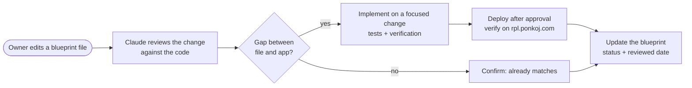
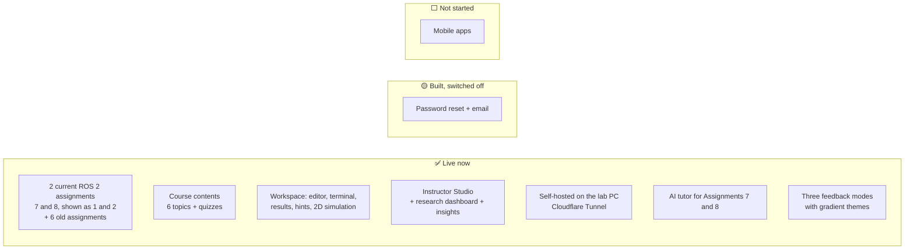
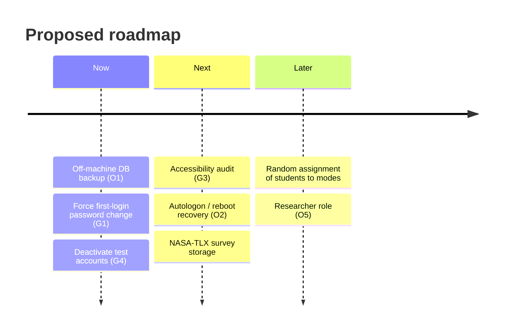

# 06 · Plan — Status, Gaps and Roadmap

> **What this file answers:** *Where are we now, what is missing, and what do we build next?*
> This is the owner's working file. Edit it freely, and the implementation is checked and updated against it.
>
> | Blueprint | [PRD](PRD.md) · [AppFlow](AppFlow.md) · [UI_Spec](UI_Spec.md) · [TRD](TRD.md) · [Schema](Schema.md) · [Plan](Plan.md) |
> |---|---|
> | Describes | Live release `a69b89b3` |
> | Last reviewed | 2026-11-20 |

---

## 1. How to use these six files

| When you want to… | Edit this file |
|---|---|
| Add or change a feature, or a rule | [PRD.md](PRD.md) |
| Change how a user gets somewhere | [AppFlow.md](AppFlow.md) |
| Change how a screen looks or behaves | [UI_Spec.md](UI_Spec.md) |
| Change hosting, APIs, security or limits | [TRD.md](TRD.md) |
| Store new data or change a table | [Schema.md](Schema.md) |
| Reprioritize work | **Plan.md** (this file) |

**Tip:** mark proposed changes with `> 💡 PROPOSAL:` so they are easy to
tell apart from what is already live.

## 2. Current state

| Area | State | Evidence |
|---|---|---|
| Backend tests | ✅ 871 passed | Local run, feedback-mode release `e17ad549` |
| Frontend tests | ✅ 266 passed, analyzer shows only 7 deprecation notes (Flutter 3.35.6) | Local, release `a69b89b3` |
| Live verification | ✅ `traditional`, `tdd` and `ai` accounts: starter, wrong and correct answers on Assignments 1 and 2, hints, simulation, AI hint and Ask the tutor | Checked on rpl.ponkoj.com, 2026-11-20 |
| Browser tests (Playwright) | 🟡 3 passed, 3 skipped (need instructor or student passwords) | Against live |
| Launcher | ✅ One launch at a time; the scheduled watchdog skips during a deploy | Tested during a real deploy |

## 3. Known gaps

### Confirmed in the code

| # | Gap | Impact | Suggested fix |
|---|---|---|---|
| G1 | `must_change_password` is stored but the app does not force a password change at first sign-in | Instructor-set passwords may never be changed | Show a "Set a new password" step after login when the flag is true |
| G3 | Accessibility not fully audited (screen reader). Theme contrast is now checked by a test (white text ≥ 4.5:1 on every gradient stop) | Possible barriers for some students | Run one audit pass and fix findings |
| G4 | Test accounts `traditional`, `tdd`, `ai` have attempts on live | They would appear in research exports | Deactivate them before data collection |

### Owner decisions and operations

| # | Item | Why it matters |
|---|---|---|
| O1 | **Off-machine database backups** | The live data exists only on one PC today |
| O2 | **Windows autologon / restart after reboot** | The stack starts from a scheduled task tied to the user session |
| O3 | **Rotate credentials** shared earlier in chat | Exposed secrets must be replaced, not only deleted |
| O4 | **Study design**: two or three groups, and how students are assigned to modes | Decides how the Accounts page is used |
| O5 | **Separate Researcher role?** | Today researchers need instructor access |

## 4. Roadmap (proposal, edit freely)

### Now

- [ ] **O1** Nightly `pg_dump` copied off the PC (cloud drive or second machine), plus a tested restore.
- [ ] **G1** First-login password change screen.
- [ ] **G4** Deactivate the `traditional`, `tdd` and `ai` test accounts before data collection.

### Next

- [ ] **G3** Accessibility audit of the workspace and Home.
- [ ] **O2** Reliable start after a power cut or reboot.
- [ ] 💡 NASA-TLX survey after the final Assignment 7 or 8 submission, stored with the feedback mode (see the study-design document).

### Later

- [ ] 💡 Random, balanced assignment of students to feedback modes.
- [ ] **O5** Researcher role with read-only research access.

## 5. Definition of done (every change)

1. Behaviour matches the updated blueprint file.
2. Focused tests pass; the full backend and frontend suites pass for larger changes.
3. CI is green.
4. The database is backed up, then the change is deployed and verified on https://rpl.ponkoj.com as a real user would.
5. The blueprint file's status and **Last reviewed** date are updated.

## 6. Change log

| Date | Change |
|---|---|
| 2026-10-26 | Blueprint created from live release `3571938b` |
| 2026-11-20 | Reviewed against live release `a69b89b3`: Assignment 8, display numbers, 2D simulation, AI tutor live for Assignments 7 and 8, three feedback modes with gradient themes, one-launch-at-a-time launcher |
