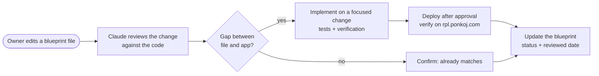
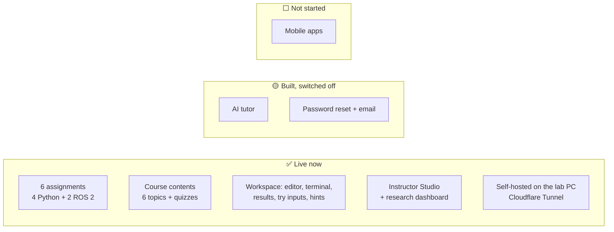
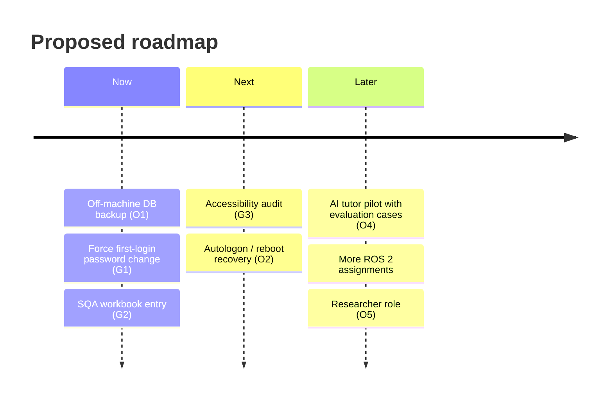

# 06 · Plan — Status, Gaps and Roadmap

> **What this file answers:** *Where are we now, what is missing, and what do we build next?*
> This is the owner's working file. Edit it freely, and the implementation is checked and updated against it.
>
> | Blueprint | [PRD](PRD.md) · [AppFlow](AppFlow.md) · [UI_Spec](UI_Spec.md) · [TRD](TRD.md) · [Schema](Schema.md) · [Plan](Plan.md) |
> |---|---|
> | Describes | Live release `3571938b` |
> | Last reviewed | 2026-10-26 |

---

## 1. How to use these six files

| When you want to… | Edit this file |
|---|---|
| Add or change a feature, or a rule | [PRD.md](PRD.md) |
| Change how a user gets somewhere | [AppFlow.md](AppFlow.md) |
| Change how a screen looks or behaves | [UI_Spec.md](UI_Spec.md) |
| Change hosting, APIs, security or limits | [TRD.md](TRD.md) |
| Store new data or change a table | [Schema.md](Schema.md) |
| Reprioritize work | **Plan.md** (this file) |

**Tip:** mark proposed changes with `> 💡 PROPOSAL:` so they are easy to
tell apart from what is already live.

## 2. Current state

| Area | State | Evidence |
|---|---|---|
| Backend tests | ✅ 726 passed | Local run, release `3571938b` |
| Frontend tests | ✅ 223 passed, analyzer clean (Flutter 3.32.8) | Local + CI |
| CI | ✅ 7 of 7 jobs green | GitHub Actions |
| Live verification | ✅ Grading messages, UTF-8 output, fractions, ROS feedback, no leaked containers | Checked on rpl.ponkoj.com |
| cloudflared | ✅ 2026.10.4 (advisory needs ≥ 2026.10.2) | Upgraded 2026-10-26 |

## 3. Known gaps

### Confirmed in the code

| # | Gap | Impact | Suggested fix |
|---|---|---|---|
| G1 | `must_change_password` is stored but the app does not force a password change at first sign-in | Instructor-set passwords may never be changed | Show a "Set a new password" step after login when the flag is true |
| G2 | The master SQA workbook has no entries for the latest fixes | Release evidence is incomplete | Add a dated run for `3571938b` |
| G3 | Accessibility not fully audited (screen reader, contrast) | Possible barriers for some students | Run one audit pass and fix findings |

### Owner decisions and operations

| # | Item | Why it matters |
|---|---|---|
| O1 | **Off-machine database backups** | The live data exists only on one PC today |
| O2 | **Windows autologon / restart after reboot** | The stack starts from a scheduled task tied to the user session |
| O3 | **Rotate credentials** shared earlier in chat | Exposed secrets must be replaced, not only deleted |
| O4 | **AI tutor decision** (key, model, study approval) | Turns on feature F15 |
| O5 | **Separate Researcher role?** | Today researchers need instructor access |

## 4. Roadmap (proposal, edit freely)

### Now

- [ ] **O1** Nightly `pg_dump` copied off the PC (cloud drive or second machine), plus a tested restore.
- [ ] **G1** First-login password change screen.
- [ ] **G2** Record release `3571938b` evidence in the master SQA workbook.

### Next

- [ ] **G3** Accessibility audit of the workspace and Home.
- [ ] **O2** Reliable start after a power cut or reboot.

### Later

- [ ] **O4** AI tutor pilot: approve evaluation cases, set quotas, and label AI answers (already built).
- [ ] 💡 Additional ROS 2 assignments using the same `ros2_topic` grader.
- [ ] **O5** Researcher role with read-only research access.

## 5. Definition of done (every change)

1. Behaviour matches the updated blueprint file.
2. Focused tests pass; the full backend and frontend suites pass for larger changes.
3. CI is green on Flutter 3.32.8.
4. The database is backed up, then the change is deployed and verified on https://rpl.ponkoj.com as a real user would.
5. The blueprint file's status and **Last reviewed** date are updated.

## 6. Change log

| Date | Change |
|---|---|
| 2026-10-26 | Blueprint created from live release `3571938b` |
