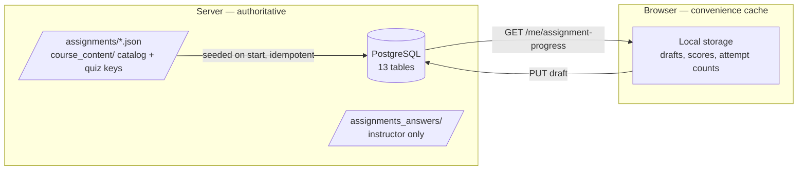
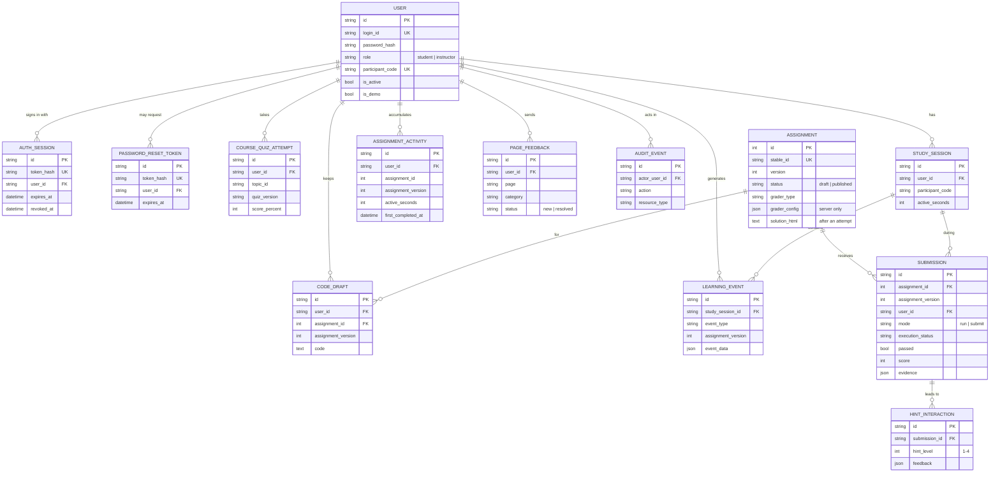

# 05 · Schema — Data Model

> **What this file answers:** *What data does the app store, where, and how do the pieces relate?*
> The detailed field-by-field research contract lives in [DATA_DICTIONARY.md](../research/DATA_DICTIONARY.md). This file is the map.
>
> | Blueprint | [PRD](PRD.md) · [AppFlow](AppFlow.md) · [UI_Spec](UI_Spec.md) · [TRD](TRD.md) · [Schema](Schema.md) · [Plan](Plan.md) |
> |---|---|
> | Describes | Live release `3571938b` · source of truth: [`backend/models.py`](../../backend/models.py) |
> | Last reviewed | 2026-10-26 |

---

## 1. Where data lives



| Store | Holds | Trust level |
|---|---|---|
| **PostgreSQL** | Accounts, sessions, assignments, attempts, drafts, quizzes, research events, feedback | Authoritative |
| **Assignment JSON** (`backend/assignments/`) | Assignment definitions, including server-only grader config and solutions | Server only |
| **Course content** (`backend/course_content/`) | Lessons, exercises, `quiz_answers.json` | Lessons public to signed-in users; answer keys server only |
| **Browser storage** | A cache of the student's own drafts and scores | Untrusted, rebuilt from the server at sign-in |
| **Demo** | Everything in memory | Discarded on refresh |

## 2. Entity-relationship diagram



## 3. Tables by purpose

| Group | Table | One row means | Written by |
|---|---|---|---|
| 👤 **Identity** | `users` | One account | Instructor tools, seeding |
| | `auth_sessions` | One sign-in (token stored only as a hash) | Login |
| | `password_reset_tokens` | One reset or invitation link | Feature-flagged reset |
| 📘 **Course** | `assignments` | One assignment at its current version | Seed, Instructor Studio |
| | `submissions` | One graded run or submit | Run / Submit |
| | `hint_interactions` | One hint shown for a submission | Get a hint |
| | `code_drafts` | Latest draft per user + assignment + version | Autosave |
| | `course_quiz_attempts` | One whole-quiz attempt | Quiz submit |
| 🔬 **Research** | `study_sessions` | One active browser study session | Research tracker |
| | `learning_events` | One allow-listed event (append-only) | Research tracker, server |
| | `assignment_activities` | Active time and completion per assignment version | Heartbeats, grading |
| 🛠️ **Operations** | `audit_events` | One sensitive admin action | Admin routes |
| | `page_feedback` | One feedback message | Feedback button |

### Allow-listed learning events

`assignment_opened` · `ai_tutor_toggled` · `workspace_tab_changed` ·
`workspace_file_selected` · `assignment_run` · `assignment_submitted` ·
`hint_requested` · `solution_revealed` (full list in
[`data_contracts.py`](../../backend/data_contracts.py)).

## 4. Assignment definition (JSON shape)

```jsonc
{
  "stable_id": "robotics-assignment-3",     // never changes
  "version": 18,                            // bump on every student-visible change
  "title": "...", "status": "published",
  "language": "python",                     // or "python-ros2"
  "assignment_html": "...",                 // instructions shown to students
  "starter_code": "...",
  "learning_objectives": ["..."],
  "execution_settings": { "timeout_seconds": 5, "allowed_imports": ["math"], "network_enabled": false },
  "public_tests": [...],                    // safe to show
  "rubric": [...],
  "common_misconceptions": [...],
  "tutoring_rules": {...},
  "simulation_config": {...},
  "asset_manifest": [...],                  // version-specific diagram URLs
  "grader_type": "python_function",         // or "python_variables", "ros2_topic"
  "grader_config": {...},                   // 🔒 SERVER ONLY: hidden cases, expected values
  "solution_html": "...",                   // 🔒 only after an attempt on this version
  "reference_solution_path": "..."          // 🔒 SERVER ONLY
}
```

## 5. Browser storage keys

Kept per signed-in user, as a cache only:

| Key | Holds |
|---|---|
| `learning.code_drafts.v1` · `learning.code_draft_versions.v1` | Current draft and the version it belongs to |
| `learning.unsynced_drafts.v1` | Drafts not yet saved to the server |
| `learning.earlier_version_drafts.v1` | Drafts kept from older versions (banner) |
| `learning.best_scores.v1` · `learning.latest_scores.v1` · `learning.attempt_counts.v1` | Progress shown on Home |
| `learning.submission_ids.v1` · `learning.revealed_solutions.v1` | Links to the latest attempt and solution state |

## 6. Data rules

| Rule | Why |
|---|---|
| Every attempt, draft, event and activity row stores `assignment_version` | Results stay comparable per exact version |
| JSON-bearing rows store `data_schema_version` | Old records stay readable after contract changes |
| Timestamps are UTC | One clock for research analysis |
| `learning_events` are append-only through the API | Research integrity |
| Exports use `participant_code`, never `login_id`, and never source code | Participant privacy |
| Schema changes use an Alembic migration (`backend/migrations/`) | Safe, repeatable upgrades |
| Seeding is idempotent and never overwrites instructor edits or student records | Live data stays safe |
| The live database is dumped before every deploy | Recovery |
