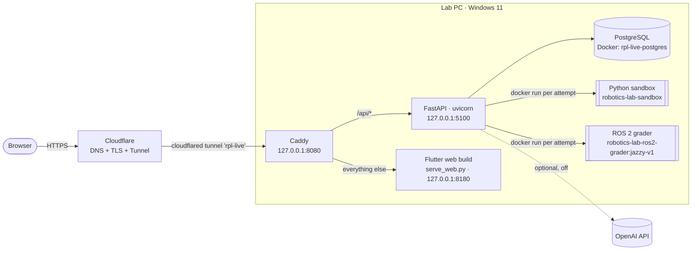
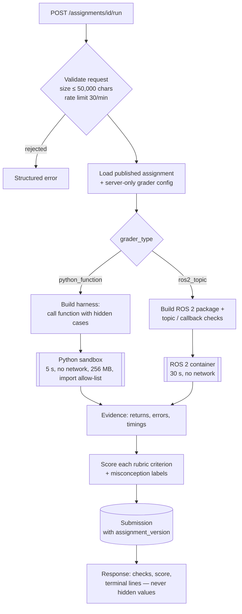

# 04 · TRD — Technical Requirements and Architecture

> **What this file answers:** *How is the system built, how do its parts talk to each other, and which technical rules must every change respect?*
>
> | Blueprint | [PRD](PRD.md) · [AppFlow](AppFlow.md) · [UI_Spec](UI_Spec.md) · [TRD](TRD.md) · [Schema](Schema.md) · [Plan](Plan.md) |
> |---|---|
> | Describes | Live release `3571938b`, self-hosted on the lab PC |
> | Last reviewed | 2026-10-26 |

---

## 1. System at a glance



| Component | Role | Why it is needed |
|---|---|---|
| **Cloudflare + cloudflared** | Public HTTPS address, tunnel into the PC | No open ports on the lab network |
| **Caddy** | One local entry point that splits `/api` from the web app | One origin means no cross-site browser calls |
| **Flutter web** | Student and instructor interface | One codebase for desktop and phone |
| **FastAPI** | Auth, assignments, grading, research, admin | Typed, fast, easy to test |
| **PostgreSQL** | All persistent data | Reliable, and schema changes go through migrations |
| **Docker sandboxes** | Run untrusted student code | Isolation: no network, time-limited, separate container per attempt |
| **OpenAI (optional)** | AI tutor explanations | An enhancement only, off by default |

## 2. Technology stack

| Layer | Technology |
|---|---|
| Frontend | Flutter 3.32.8 (CI pin), Dart, `flutter_code_editor` 0.3.5, `http`, `shared_preferences` |
| Backend | Python 3.14, FastAPI 0.141, SQLAlchemy 2.0, Alembic 1.16, Pydantic Settings, psycopg 3 |
| Database | PostgreSQL in Docker (live) · Neon PostgreSQL (staging) · SQLite (automated tests only) |
| Execution | Docker images `robotics-lab-sandbox:latest` and `robotics-lab-ros2-grader:jazzy-v1` |
| Hosting | Lab PC, Caddy, Cloudflare Tunnel, Windows scheduled task **RPL-Live** (re-checks every 5 min) |
| CI | GitHub Actions ([`ci.yml`](../../.github/workflows/ci.yml)): 7 jobs, backend + frontend + build |

## 3. Code map

```text
frontend/lib/
  screens/    pages (login, home, workspace, contents, instructor pages)
  widgets/    reusable parts (terminal, try-inputs dialog, banners, feedback)
  services/   typed API clients — the ONLY place that talks HTTP
  state/      learner progress and drafts (local cache)
  models/     transport objects
backend/
  app.py                     routes (thin) + app composition
  auth_service.py            passwords, sessions
  assignment_repository.py   load and save assignments
  graders/                   python_function · python_variables · ros2_topic
  sandbox.py                 Docker / remote / subprocess execution
  tutor.py · hinter.py       built-in hints + optional AI
  research_service.py        study sessions, events, exports
  course_content_repository.py   lessons + server-side quiz grading
  migrations/                Alembic schema history
```

## 4. Grading pipeline



**Execution outcomes** (`execution_status`): `completed` · `syntax_error` ·
`runtime_error` · `timeout` · `rejected` · `grader_unavailable` ·
`internal_error` · `execution_error`.

## 5. API catalog

All routes are served under `/api` on the public address. 🔐 = signed-in user, 🛡️ = instructor only.

| Group | Routes |
|---|---|
| **Health** | `GET /health` |
| **Auth** | `POST /auth/login` · `POST /auth/demo` · 🔐 `GET /auth/me` · 🔐 `POST /auth/logout` · 🔐 `POST /auth/change-password` · `POST /auth/forgot-password`* · `POST /auth/reset-password`* |
| **Assignments** 🔐 | `GET /assignments` · `GET /assignments/{id}` · `GET/PUT/DELETE /assignments/{id}/draft` · `POST …/format` · `POST …/run` · `POST …/submit` · `POST …/playground` · `POST …/hint` · `POST …/tutor` · `POST …/solution` · legacy `POST /grade/{id}` |
| **Progress** 🔐 | `GET /me/assignment-progress` |
| **Course content** 🔐 | `GET /contents` · `GET /contents/{topic}` · `GET /contents/{topic}/sections/{section}` · `POST /contents/{topic}/quiz/submit` · `GET /contents/{topic}/quiz/attempts` · `GET /content-assets/{name}` · `GET /images/{id}` |
| **Research** 🔐 | `POST /research/sessions` · `POST …/{sid}/heartbeat` · `POST …/{sid}/events` · `POST …/{sid}/end` · `GET /research/me` · `GET /research/me/attempts` · `GET /research/metrics` |
| **Feedback** | 🔐 `POST /feedback` · 🛡️ `GET /admin/feedback` · 🛡️ `PATCH /admin/feedback/{id}` |
| **Admin: assignments** 🛡️ | `GET/POST /admin/assignments` · `PUT /admin/assignments/{id}` · `POST …/{id}/validate` · `POST …/{id}/publish` |
| **Admin: accounts** 🛡️ | `GET/POST /admin/students` · `PATCH /admin/students/{id}` · `POST …/{id}/reset-password` · same four for `/admin/instructors` · `POST /admin/accounts/import` · `GET /admin/sign-in-history` |
| **Admin: research** 🛡️ | `GET /admin/research/summary` · `…/assignments` · `…/students/{id}` · `…/students/{id}/attempts` · `…/export` |
| **Admin: email** 🛡️ | `GET /admin/email/status`* · `POST /admin/email/test`* |

\* Behind feature flags, off on live.

## 6. Security requirements

| Area | Requirement | How it is met today |
|---|---|---|
| Passwords | Strong salted hashes only | `auth_service.py`. Passwords and tokens are never logged |
| Sessions | Server-side, revocable, expiring | `auth_sessions` table stores only a token hash; 12 h lifetime |
| Authorization | Server-enforced roles | `admin_dependency` on every `/admin/*` route; identity always comes from the session |
| Secrets | Never in Git or in the client | Ignored root `.env`; Flutter only gets `API_BASE_URL` |
| Untrusted code | Isolated and bounded | Separate Docker container per attempt: `--network none`, 256 MB memory, 1 CPU, 64 processes, time limit, import allow-list; a timed-out container is force-removed |
| Data leaks | Hidden tests and solutions stay server-side | Responses carry checks and evidence, never expected values |
| Abuse | Rate limits per user/address | Execution 30/min · tutor 10/min · auth 120/min · admin 300/min · general 60/min · request ≤ 100 KB |
| Transport | HTTPS end to end | Cloudflare TLS; local services bind to 127.0.0.1 only |
| Headers | Safe defaults | Security middleware; JSON is always `charset=utf-8` |

## 7. Configuration (root `.env`, values not shown)

| Setting | Live value | Meaning |
|---|---|---|
| `ENVIRONMENT` | `production` | Strict mode: no wildcard CORS, no automatic schema creation |
| `SELF_HOSTED_DATABASE` | `true` | Use the lab PC's PostgreSQL |
| `SANDBOX_BACKEND` | `docker` | `docker` · `remote` · `subprocess` (tests only) |
| `ENABLE_DEMO_ACCOUNTS` | `true` | Public student demo |
| `ENABLE_PASSWORD_RESET` / `ENABLE_EMAIL_FEATURES` | `false` | Self-service reset and email |
| `OPENAI_API_KEY` | not set | AI tutor unavailable, so built-in hints are used |
| `AUTH_SESSION_HOURS` | default 12 | Sign-in lifetime |

## 8. Environments

| Environment | Where | Database | Purpose |
|---|---|---|---|
| **Live** | Lab PC (`C:\RPL-Live`) → rpl.ponkoj.com | Local PostgreSQL (Docker) | Real classroom use |
| **Staging** | Canonical OneDrive checkout | Neon `robotics_lab_staging` | Development and SQA |
| **Tests** | CI / local | SQLite or disposable PostgreSQL | Automated checks only |

## 9. Non-functional targets

| Quality | Target |
|---|---|
| Availability without AI | 100 % of core features |
| Concurrency | 2 executions at once per API process (queue beyond) |
| Recovery | The scheduled task restarts a partly stopped stack within 5 min; database dumped before every deploy |
| Data | UTC timestamps; every attempt and event stores the assignment version and `data_schema_version` |
| Quality gate | Backend + frontend tests, analyzer, web build and CI green before deploy |
